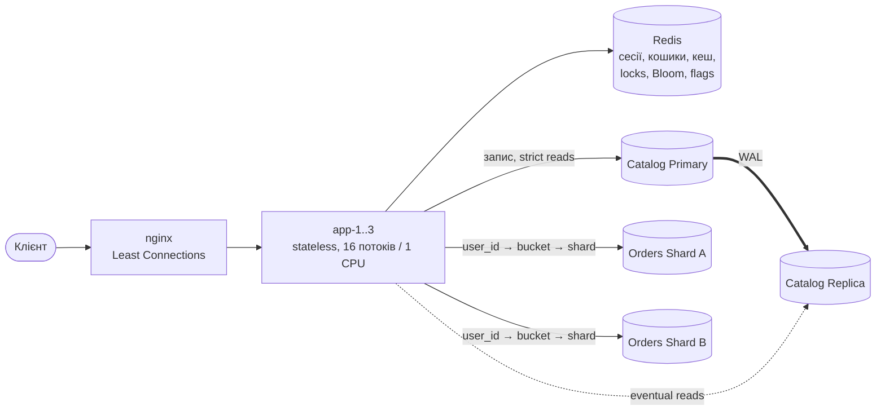

# Shop — високонавантажений інтернет-магазин

Наскрізний проєкт з курсу «Інженерія високонавантажених систем» (ЛР 1–10): від MVP на одній БД до розподіленої системи з балансуванням, кешем, реплікацією, шардингом і захистом кешованого шару. Кожне рішення перевірено навантажувальними тестами.

**Стек:** Java 21, Spring Boot 3.5, PostgreSQL 17 (Primary + Replica + 2 шарди), Redis 7.4, nginx 1.27, k6, podman/docker compose. Інструменти діагностики: async-profiler, JFR, OpenTelemetry + Jaeger, pg_stat_statements.

## Фінальна архітектура



Детально: [docs/lab10-final.md](docs/lab10-final.md) (C4, Request Flow, SPOF, консистентність, вартість складності).

## Результат: Baseline (ЛР5) vs Final

Тотожне середовище і профіль навантаження; baseline перевиміряно на тих самих даних ([деталі](docs/lab10-final.md#4-baseline-vs-final)).

| Сценарій | Stable Throughput, RPS (baseline → final) | p99 @ 100 VUs, мс (baseline → final) |
|---|---|---|
| A — читання каталогу | 5 530 → **9 900 (+79 %)** | 95 → 87 |
| C — повний workflow покупки | 2 220 → **4 220 (+90 %)** | 485 → **95 (−80 %)** |
| B — запис замовлень | 1 910 → 1 400 (**−27 %**, ціна Saga + fsync, див. розділ 4.2) | 185 → 186 |

## Швидкий старт

```bash
podman-compose up -d --build        # або docker compose up -d --build (~10 контейнерів)
curl -XPOST localhost:8080/api/admin/shards/migrate-legacy   # одноразово: замовлення з каталогу → шарди
scripts/smoke.sh                    # демонстрація основних endpoints
```

* API: `http://localhost:8080/api/...`, Swagger UI: `http://localhost:8080/swagger-ui.html`
* Тестові користувачі: `user1@shop.test` … `user2000@shop.test`, пароль `password`
* Діагностика: `/health`, `/api/admin/replication`, `/api/admin/shards`, `/api/admin/flags`, `/actuator/metrics`
* Трасування: `podman-compose --profile tracing up -d jaeger` + `OTEL_AGENT=-javaagent:/profiling-tools/opentelemetry-javaagent.jar podman-compose up -d app-1 app-2 app-3` → `http://localhost:16686`
* Профілювальники (`profiling/tools`, не в git): async-profiler 4.6 і opentelemetry-javaagent 2.33 з GitHub Releases

## Звіти з лабораторних робіт

| ЛР | Тема | Звіт | Ключовий результат |
|---|---|---|---|
| 1 | System Design, MVP | [docs/lab01-system-design.md](docs/lab01-system-design.md) | 15+ endpoints, ER, C4, 6 гіпотез вузьких місць |
| 2 | Stateless Architecture | [docs/lab02-stateless.md](docs/lab02-stateless.md) | сесії/кошики → Redis; kill інстансу — 0 втрачених замовлень |
| 3 | Horizontal Scaling, Load Balancing | [docs/lab03-horizontal-scaling.md](docs/lab03-horizontal-scaling.md) | read ×3.3 на 3 вузлах; LC ×5.7 проти RR при повільному вузлі |
| 4 | Distributed Caching | [docs/lab04-distributed-caching.md](docs/lab04-distributed-caching.md) | Cache-Aside, версіонована інвалідація, fallback при падінні Redis |
| 5 | Load & Performance Baseline | [docs/lab05-load-baseline.md](docs/lab05-load-baseline.md) | k6 A/B/C, saturation, Coordinated Omission; bottleneck — seq scan історії (95.8 % часу БД) |
| 6 | Replication, Read/Write Separation | [docs/lab06-replication.md](docs/lab06-replication.md) | streaming replication, RYW-fence, primary fallback, read-only mode; знайдено каскадну відмову |
| 7 | Sharding, Partitioning | [docs/lab07-sharding.md](docs/lab07-sharding.md) | virtual buckets, Saga, scatter-gather; hot shard (REGION) vs BUCKETS +62 % |
| 8 | Resilience: Stampede, Avalanche, Penetration | [docs/lab08-resilience.md](docs/lab08-resilience.md) | 500 MISS → 1 перерахунок; TTL jitter −54 % піку; Bloom −100 % penetration |
| 9 | Performance Profiling | [docs/lab09-profiling.md](docs/lab09-profiling.md) | root cause: немає індексу + N+1; історія ×3.3, запит ×52 |
| 10 | Final Optimization, Architecture Review | [docs/lab10-final.md](docs/lab10-final.md) | bulkhead + LC (+85 % C), Baseline vs Final, SPOF, Failure Review |

Стан коду після кожної ЛР позначено git-тегом `labN` (`git checkout lab6`). Розподіл відповідальності (RACI) — у [ЛР1](docs/lab01-system-design.md#5-розподіл-відповідальності-raci).

## Структура репозиторію

| Шлях | Вміст |
|---|---|
| `src/main/java/ua/highload/shop/` | `api` (REST), `service`, `repo` (JDBC), `cache` (Cache-Aside, StampedeGuard, Bloom, flags), `db` (R/W routing), `shard` (router, registry, migration), `config` |
| `src/main/resources/db/migration`, `db/shard` | Flyway: каталог і шарди |
| `compose.yaml`, `nginx/`, `haproxy/`, `db/` | розгортання, конфігурація LB, реплікація |
| `load-tests/` | k6-сценарії (`scenarios.js` — A/B/C, `lab3/`, `lab7/`, `lab8/`, `open-model.js`) |
| `scripts/` | відтворювані експерименти кожної ЛР, генератори таблиць і графіків |
| `results/` | сирі результати вимірювань (k6 summary JSON, CPU з cgroup, SQL/с) |
| `profiling/` | flame graphs, EXPLAIN, pg_stat_statements, трейси, JFR-зведення |
| `docs/` | звіти ЛР1–10, графіки (`docs/img`) |

## Методичні нотатки

* Усі числа виміряно на одному хості (Intel i5-12500H, 16 потоків, NVMe/btrfs, rootless podman) з фіксованими лімітами CPU/пам'яті контейнерів; k6 прив'язаний до окремих ядер.
* Обов'язковий тривалий прогрів: при 1 CPU на інстанс JIT (C2) компілює гарячий код хвилинами, без прогріву результати занижені в рази (ЛР3, ЛР9).
* Перед кожним порівняльним виміром дані скидаються до seed-стану (`scripts/reset-data.sh`), а ключові порівняння зроблено як ABAB на тих самих JVM (індекс через DDL, N+1 і захист кешу через feature flags, LB-алгоритм наживо).
