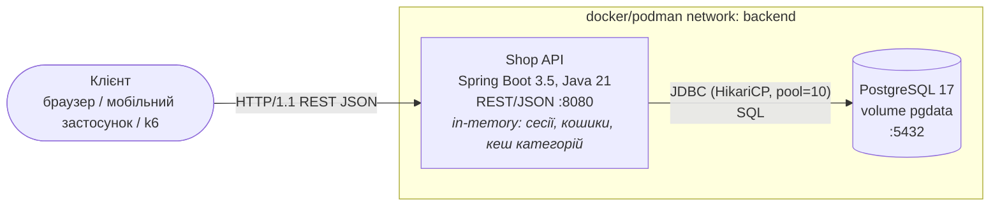

# ЛР № 1 — System Design та базовий прототип

## 1. Доменний аналіз

**Предметна область:** інтернет-магазин (каталог товарів, кошик, оформлення замовлень, аналітика продажів).

### Сутності та зв'язки

```mermaid
erDiagram
    USERS ||--o{ ORDERS : "оформлює"
    CATEGORIES ||--o{ PRODUCTS : "містить"
    ORDERS ||--|{ ORDER_ITEMS : "складається з"
    PRODUCTS ||--o{ ORDER_ITEMS : "входить до"

    USERS { bigint id PK; varchar email UK; varchar full_name; varchar region; varchar password_hash; timestamptz created_at }
    CATEGORIES { bigint id PK; varchar name UK }
    PRODUCTS { bigint id PK; bigint category_id FK; varchar name; text description; bigint price_cents; int stock; timestamptz updated_at }
    ORDERS { bigint id PK; bigint user_id FK; varchar status; bigint total_cents; timestamptz created_at }
    ORDER_ITEMS { bigint order_id PK; bigint product_id PK; int quantity; bigint price_cents }
```

| Сутність | Призначення | Профіль доступу |
|---|---|---|
| `users` | покупці; `region` використовується для доставки | читання при логіні/профілі, рідкі записи |
| `categories` | довідник категорій | майже лише читання |
| `products` | каталог; `stock` — залишок на складі | **read-heavy** (каталог), запис при checkout (списання) |
| `orders` + `order_items` | замовлення (агрегат) | **write-heavy** (checkout), читання історії, аналітика |
| кошик | тимчасовий стан покупця до оформлення | часті дрібні записи/читання |

Гроші зберігаються в копійках (`BIGINT price_cents`), щоб уникнути похибок з плаваючою комою.

### Специфікація API

Повна OpenAPI-специфікація: `http://localhost:8080/swagger-ui.html` (`/v3/api-docs`).

| Метод | Endpoint | Опис | Коди відповіді |
|---|---|---|---|
| POST | `/api/users` | реєстрація покупця | 201, 400, 409 (email зайнятий) |
| GET | `/api/users/{id}`, `/api/users/me` | профіль | 200, 401, 404 |
| POST | `/api/auth/login` / `/api/auth/logout` | вхід (Bearer-токен) / вихід | 200, 401 / 204 |
| GET | `/api/categories` | довідник категорій | 200 |
| GET | `/api/products?categoryId&page&size` | каталог з пагінацією | 200, 400 |
| GET | `/api/products/{id}` | картка товару | 200, 404 |
| POST/PUT/DELETE | `/api/products[/{id}]` | CRUD товару (адмін) | 201/200/204, 400, 404, 409 |
| GET/POST/DELETE | `/api/cart`, `/api/cart/items[/{productId}]` | кошик поточного користувача | 200, 401, 404 |
| POST | `/api/orders` | **checkout**: з кошика або з тіла `{"items":[...]}` | 201, 401, 404, 409 (нема на складі) |
| GET | `/api/orders/{id}`, `/api/orders/my` | замовлення / історія замовлень | 200, 401, 404 |
| GET | `/api/stats/top-products?limit` | топ товарів за продажами (агрегація) | 200 |
| GET | `/api/stats/summary` | кількість замовлень з моменту старту | 200 |

Помилки повертаються у форматі RFC 7807 (`application/problem+json`) з полем `errors` для помилок валідації.

### Піковий сценарій навантаження (High-Load Scenario)

**Розпродаж (flash sale):** тисячі користувачів одночасно переглядають каталог і картки популярних товарів, а потім оформлюють замовлення на ті самі товари.

* `GET /api/products/*` — масові читання (дані розподілені за законом Ципфа: перший товар купують у ~4 рази частіше, ніж другий);
* `POST /api/orders` — транзакція: `SELECT … FOR UPDATE` рядків товарів → перевірка залишку → `UPDATE stock` → `INSERT orders` + batch `INSERT order_items`. Конкурентні замовлення того самого товару серіалізуються на блокуванні рядка;
* `GET /api/stats/top-products` — повна агрегація `order_items` (≈150 тис. рядків) на кожен виклик.

## 2. Архітектура (C4 — Container level)



Шари застосунку (`src/main/java/ua/highload/shop`):

| Пакет | Відповідальність |
|---|---|
| `api` | REST-контролери, DTO з Bean Validation, `ApiExceptionHandler` (Problem Details) |
| `service` | бізнес-логіка: checkout у транзакції, кошик, сесії, статистика |
| `repo` | Persistence Layer на `NamedParameterJdbcTemplate` (явний SQL — легше аналізувати плани запитів) |
| `domain` | record-моделі та доменні винятки |
| `db/migration` | Flyway-міграції: `V1__schema.sql` (DDL), `V2__seed.sql` (детерміновані тестові дані) |

Зовнішніх інтеграцій і черг на цьому етапі немає.

**Обґрунтування стилю:** модульний моноліт. Для MVP дешевше одне розгортання, ніж мікросервіси, а розділення на шари (`api/service/repo`) дає змогу пізніше винести стан і масштабувати горизонтально (ЛР 2–3), не переписуючи бізнес-логіку.

## 3. Персистентність і відтворюваність

* СУБД: PostgreSQL 17 у контейнері, дані на іменованому томі `pgdata` (перевірено: після `podman restart shop_postgres_1` і `compose down && up` дані зберігаються).
* Схема створюється Flyway автоматично під час старту застосунку.
* Seed: 20 категорій, 10 000 товарів, 2 000 користувачів (`user{N}@shop.test` / `password`), 50 000 замовлень, ≈150 000 позицій.

Запуск: `podman-compose up -d --build` (або `docker compose up -d --build`), перевірка: `scripts/smoke.sh`.

## 4. Аналіз потенційних вузьких місць (Bottleneck Analysis)

| # | Компонент / операція | Причина (Root Cause) | Симптоматика |
|---|---|---|---|
| 1 | `POST /api/orders` → `SELECT … FOR UPDATE` на популярних товарах | **Lock contention:** усі замовлення товару №1 серіалізуються на одному рядку; транзакція тримає блокування і з'єднання до `COMMIT` | Throughput checkout упирається в 1/(час транзакції) для гарячого товару; p99 росте нелінійно, бо запити стоять у черзі на блокування |
| 2 | HikariCP (10 з'єднань) проти Tomcat (200 потоків) | **Connection Pool Exhaustion:** коли запитів більше за 10, вони чекають з'єднання (`connection-timeout=3s`) | Ріст p95/p99 латентності, далі HTTP 500 `SQLTransientConnectionException`; на DB CPU не завантажений («тихе» насичення) |
| 3 | `GET /api/orders/my` | **N+1:** 1 запит на замовлення і ще N запитів на позиції; **немає індексу** `orders(user_id)` → `Seq Scan on orders` (50 тис. рядків, 2.4 мс і росте лінійно з обсягом) | Латентність росте разом з обсягом таблиці; надлишкові round-trip'и тримають з'єднання з пулу довше |
| 4 | `GET /api/stats/top-products` | Повна агрегація `order_items` на кожен запит (`Seq Scan`, ≈20 мс CPU на БД) | Під навантаженням споживає CPU БД і з'єднання, тисне на інші запити; кандидат на кешування |
| 5 | Сесії, кошики, кеш категорій у пам'яті процесу | **Stateful-інстанс:** стан прив'язаний до JVM | Неможливо запустити 2+ інстанси без sticky sessions; рестарт = втрата сесій і кошиків; ріст heap (GC-паузи) |
| 6 | `OFFSET`-пагінація каталогу | Для глибоких сторінок БД читає й відкидає `page*size` рядків | Латентність глибоких сторінок росте лінійно |

Ці гіпотези перевіряються кількісно в ЛР 5 (навантажувальне тестування) і ЛР 9 (профілювання).

## 5. Розподіл відповідальності (RACI)

> Заповніть реальними іменами учасників команди.

| Модуль | Учасник 1 | Учасник 2 | Учасник 3 |
|---|---|---|---|
| Доменна модель, міграції, seed (`db/migration`, `repo`) | **R/A** | C | I |
| REST API, валідація, обробка помилок (`api`) | C | **R/A** | I |
| Checkout, кошик, сесії (`service`) | C | **R** | **A** |
| Контейнеризація, compose, smoke-тести | I | C | **R/A** |
| Аналіз вузьких місць, документація | **R** | C | **A** |

## 6. Питання до захисту (коротко)

* **Чому моноліт?** Один процес простіше розгортати й налагоджувати. Шари `api/service/repo` відокремлені, тож горизонтально масштабувати можна без переписування.
* **Чому JdbcTemplate, а не JPA?** Явний SQL дає повний контроль над `FOR UPDATE`, batch-вставками та планами виконання, і в ньому не буває прихованих lazy-loading N+1.
* **Як уникаємо deadlock'ів при checkout?** Рядки товарів блокуються в детермінованому порядку (`ORDER BY id FOR UPDATE`, ключі в `TreeMap`).
* **Як гарантується консистентність складу?** Перевірка залишку й списання виконуються в одній транзакції під блокуванням рядка, плюс `CHECK (stock >= 0)` на рівні БД.
