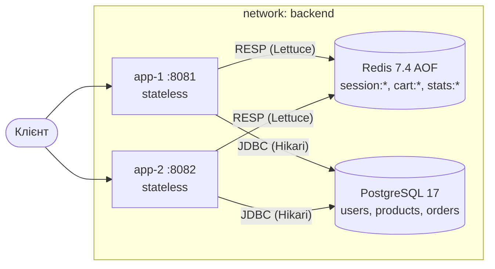

# ЛР № 2 — Stateless Application Architecture

## 1. Аудит стану (State Audit)

Під час аудиту коду ЛР1 перевірено всі поля сервісних бін (Spring-сінглтонів), статичні поля, колекції та файлові ресурси.

| Категорія | Що знайдено (ЛР1) | Де | Рішення (ЛР2) |
|---|---|---|---|
| **Ephemeral / Local Safe** | логи, метрики Actuator/Micrometer, пул з'єднань HikariCP, `SecureRandom` у `PasswordHasher`, локальні змінні запиту | весь код | залишено: це не бізнес-стан, його втрата нічого не ламає |
| **Shared / Externalized** | товари, користувачі, замовлення, склад | PostgreSQL | уже зовнішні (ЛР1) |
| **Critical Stateful** | `Map<String, Long> sessions` — сесії | `AuthService` | **усунуто:** Redis `session:<token>` → userId, ковзний TTL 30 хв (`SET EX` / `GETEX`) |
| **Critical Stateful** | `Map<Long, Map<Long,Integer>> carts` — кошики | `CartService` | **усунуто:** Redis hash `cart:<userId>`, атомарні `HINCRBY`/`HDEL`, TTL 7 днів |
| **Critical Stateful** | `AtomicLong ordersCreated` — локальний лічильник | `StatsService` | **усунуто:** Redis `INCR stats:orders-created` (атомарний глобальний лічильник) |
| **Critical Stateful** | `volatile List<Category> cached` — локальний кеш без інвалідації | `CategoryService` | **усунуто:** читання з БД (розподілений кеш з'явиться в ЛР4). Локальний кеш на N інстансах дає N різних версій даних після зміни |
| Application-level locks | немає `synchronized`/`ReentrantLock` у бізнес-логіці; конкуренція за склад вирішується `SELECT … FOR UPDATE` у БД | `OrderService` | залишено: блокування вже в спільному сховищі |
| Файлові сесії / локальні файли | немає | — | — |

Перевірка, що прихованого стану не лишилось:

```bash
grep -rnE "static (final )?(Map|List|Set)<|new (ConcurrentHashMap|AtomicLong|AtomicInteger)|synchronized|private (final )?(Map|List|Set)<" src/main/java
# → порожньо
```

Redis запущено з `appendonly yes` (AOF, fsync щосекунди), бо сесії й кошики — це бізнес-стан. Перевірено, що сесія переживає `podman restart shop_redis_1`: після рестарту запит із тим самим токеном отримав `200`.

## 2. Stateless Request Flow: «додати в кошик → оформити замовлення»

```mermaid
sequenceDiagram
    autonumber
    participant C as Клієнт
    participant A1 as app-1
    participant A2 as app-2
    participant R as Redis
    participant DB as PostgreSQL
    C->>A1: POST /api/auth/login
    A1->>DB: SELECT id, password_hash FROM users
    A1->>R: SET session:<token> userId EX 1800
    A1-->>C: {token}
    C->>A2: POST /api/cart/items (Bearer token)
    A2->>R: GETEX session:<token> EX 1800 → userId
    A2->>DB: SELECT product (чи існує)
    A2->>R: HINCRBY cart:<userId> <productId> <qty>; EXPIRE
    A2-->>C: кошик
    C->>A1: POST /api/orders (Bearer token)
    A1->>R: GETEX session → userId; HGETALL cart:<userId>
    A1->>DB: BEGIN; SELECT … FOR UPDATE; UPDATE stock; INSERT orders/items; COMMIT
    A1->>R: DEL cart:<userId>; INCR stats:orders-created
    A1-->>C: 201 order
```

* **Вхідний контекст:** заголовок `Authorization: Bearer <token>` + тіло запиту. Інстанс нічого не «пам'ятає» між запитами.
* **Читання контексту:** `GETEX session:*` (зразу продовжує TTL), `HGETALL cart:*`.
* **Атомарні зміни:** `HINCRBY` у Redis, транзакція з блокуваннями рядків у PostgreSQL, `INCR` лічильника.
* **Після завершення запиту** в пам'яті JVM нічого не лишається: усі об'єкти локальні для потоку запиту.

Відома межа атомарності: між `HGETALL cart` і `DEL cart` інший запит може додати товар, і тоді він пропаде з кошика. Щоб цього не було, потрібен `WATCH/MULTI` або Lua-скрипт; для навчального кошика цей ризик прийнятний.

## 3. Мульти-інстансне розгортання

`compose.yaml` піднімає `app-1` (`:8081`) і `app-2` (`:8082`) з одного образу `localhost/shop-app`, а також спільні `postgres` і `redis`. `InstanceIdFilter` додає до кожної відповіді заголовок `X-Instance-ID` (значення `INSTANCE_ID`, за замовчуванням hostname контейнера).



## 4. Тестування консистентності та відмов

### Cross-Instance Consistency — `scripts/lab2-cross-instance.sh`

Повний вивід: [results/lab02/cross-instance.txt](results/lab02/cross-instance.txt).

| Крок | Інстанс | Результат |
|---|---|---|
| POST товар «Cross v1» | app-1 | 201 |
| GET товар | app-2 | 200, «Cross v1» |
| PUT «Cross v2», ціна 1500 | app-2 | 200 |
| GET товар | app-1 | 200, «Cross v2» — актуальні дані |
| логін | app-1 | токен |
| додати в кошик (товар 10002 ×2) | app-2 | сесію з app-1 прийнято |
| додати в кошик (товар 2 ×1) | app-1 | у кошику 2 позиції |
| GET кошик | app-2 | 2 позиції |
| checkout | app-1 | 201, кошик з Redis |
| GET історія / кошик | app-2 | замовлення видно, кошик порожній |
| `/api/stats/summary` | app-1 / app-2 | однаковий `ordersCreatedTotal` |

Sticky sessions не використовуються: клієнт свідомо чергує інстанси.

### Restart / Instance Loss — `scripts/lab2-instance-loss.sh`

Сесію й кошик створено через app-1. Далі 40 checkout-запитів по черзі на app-1/app-2; на 20-му запиті `podman kill shop_app-1_1` (SIGKILL, без graceful shutdown). Якщо інстанс недоступний, клієнт повторює запит на іншому (у ЛР3 цю роль бере балансувальник).

Результат ([results/lab02/instance-loss.txt](results/lab02/instance-loss.txt)):

```
>>> podman kill shop_app-1_1
#20 201 app-2
...
кошик після аварії (через app-2): {"userId":2005,"items":[{"productId":5,"quantity":1}]}
Успішних відповідей клієнту: 40, повторів на інший інстанс: 10, помилок: 0
Замовлень у БД для user=2005: 40
```

* сесія і кошик, створені на вбитому інстансі, доступні на app-2;
* кількість замовлень у БД збігається з кількістю успішних відповідей, тож бізнес-стан не втрачено;
* незавершена транзакція на вбитому інстансі не закомітилась (PostgreSQL відкочує її, коли рветься з'єднання).

Ризик, про який треба знати: якщо інстанс упаде **після** `COMMIT`, але **до** відправки відповіді, повтор на інший інстанс створить дубль замовлення. Рішення — `Idempotency-Key` у заголовку з унікальним індексом у БД (у цій серії такого вікна не виникло: 40 = 40).

## 5. Питання до захисту

* **Stateless ≠ «без даних».** Дані є, але вони живуть у спільних сховищах (PostgreSQL, Redis), а не в пам'яті процесу. Інстанс — це лише обчислення, тому будь-який інстанс може обробити будь-який запит, а його втрата не втрачає стану.
* **Ризики прихованої affinity.** Локальні кеші (різні версії даних на інстансах), in-memory сесії (користувача «розлогінює», коли запит потрапляє на інший вузол), локальні lock'и (не захищають від гонки між інстансами), файли на локальному диску, WebSocket-з'єднання, локальні лічильники й rate limiter'и. Sticky sessions маскують ці проблеми, поки вузол не впаде.
* **Чому Redis, а не БД для сесій?** Доступ O(1) за ~0.2 мс, вбудований TTL і атомарні операції над hash. PostgreSQL лишається джерелом істини для бізнес-транзакцій.
* **Що буде, якщо впаде Redis?** Сесії й кошики стануть недоступні, але тепер Redis — нова спільна залежність: її відмовостійкість розглядається в ЛР4 (fallback) і ЛР10 (SPOF).
