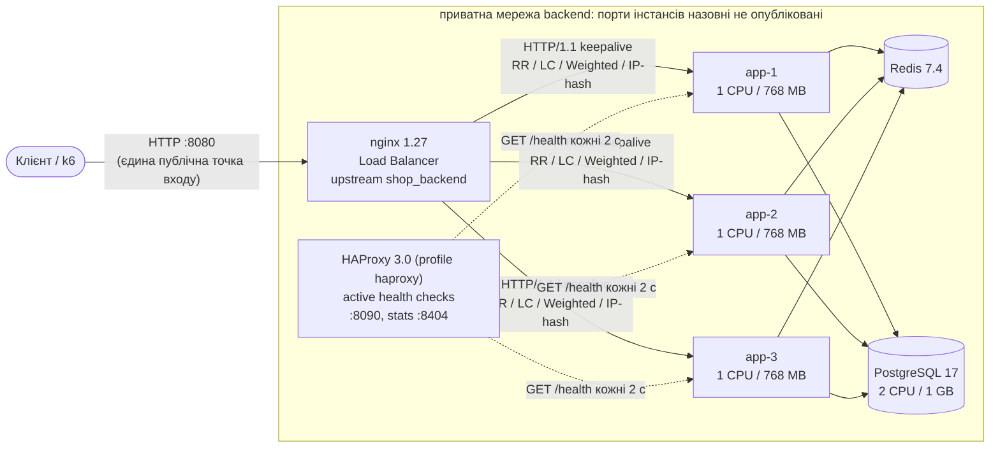

# ЛР № 3 — Horizontal Scaling та Load Balancing

## 1. Топологія



* **Інкапсуляція:** у `compose.yaml` порти `app-*` не публікуються. Назовні доступні лише `:8080` (nginx), а також `127.0.0.1:5432` і `127.0.0.1:6379`, прив'язані до localhost для адміністрування. Прямий запит `curl localhost:8081` не проходить.
* **Ресурси** (фіксовані для ЛР3–ЛР10): app — `cpus: 1.0`, `mem_limit: 768m`; PostgreSQL — 2 CPU / 1 GB; Redis — 1 CPU; nginx — 1 CPU. Load generator (k6) прив'язаний до ядер 12–15 (`taskset`).
* **Хост:** Intel i5-12500H (4P+8E ядер, 16 потоків), 16 GB RAM, NVMe, Fedora, rootless podman 5.8.

Конфігурація: [`nginx/default.conf.template`](../nginx/default.conf.template), `nginx/upstream-*.conf` (по одному файлу на алгоритм), [`haproxy/haproxy.cfg`](../haproxy/haproxy.cfg).

## 2. Алгоритми балансування

Алгоритм обирається змінною `LB_ALGO` під час старту (`LB_ALGO=least-conn podman-compose up -d lb`) або **перемикається наживо** без втрати з'єднань:

```bash
scripts/lb-switch.sh least-conn     # sed include-рядка + nginx -s reload (graceful)
```

### 2.1 Однорідні вузли — 20 VUs, 20 с, `GET /api/products/{id}`

| Алгоритм | RPS | avg, мс | p50, мс | p95, мс | p99, мс | Errors | Розподіл (app-1 / app-2 / app-3) |
|---|---|---|---|---|---|---|---|
| Round Robin | 11 449 | 1.7 | 0.8 | 3.8 | 22.3 | 0 % | 76 338 / 76 338 / 76 339 |
| Least Connections | 15 681 | 1.2 | 0.6 | 2.0 | 21.3 | 0 % | 111 217 / 99 087 / 103 436 |
| Weighted RR (3:1:1) | 4 186 | 4.6 | 1.5 | 20.6 | 66.6 | 0 % | 50 229 / 16 742 / 16 743 |
| IP Hash | 4 400 | 4.4 | 0.7 | 26.1 | 79.0 | 0 % | 0 / 0 / 88 012 |

Що видно:

* **Round Robin** розподіляє запити ідеально рівно (±1). Але в замкненій моделі навантаження (кожен VU чекає на відповідь) загальний темп задає найповільніший вузол.
* **Least Connections** навіть на «однакових» вузлах дає +37 % RPS. Вузли фактично неоднакові: гібридний CPU (P- і E-ядра), різний стан JIT-компіляції, CFS-throttling. LC віддає більше запитів тому вузлу, який зараз швидше звільняється.
* **Weighted 3:1:1** точно відтворює ваги (60 % / 20 % / 20 %). Але вузли тут фізично однакові (по 1 CPU), тому app-1 стає вузьким місцем. Ваги мають відповідати реальній потужності вузлів, а не бути довільними.
* **IP Hash:** усі запити k6 приходять з однієї IP-адреси, тож 100 % трафіку дісталося одному вузлу. Так виглядає прив'язка на мережевому рівні: працює як «sticky session», але один великий NAT або корпоративний проксі легко створює гарячий вузол. Stateless-застосунку (ЛР2) ця прив'язка не потрібна.

### 2.2 Асиметричне навантаження — app-3 з синтетичною затримкою +100 мс

Затримка вмикається змінною `APP3_DELAY_MS=100` (`ArtificialDelayFilter` робить `Thread.sleep` для `/api/**`). Навантаження — 50 VUs, 30 с.

| Алгоритм | RPS | p50, мс | p95, мс | p99, мс | Розподіл (app-1 / app-2 / app-3) | CPU app-1 / app-2 / app-3 (ядер) |
|---|---|---|---|---|---|---|
| Round Robin | 1 442 | 1.2 | 102.3 | 104.1 | 14 468 / 14 468 / 14 467 | 0.16 / 0.16 / 0.24 |
| **Least Connections** | **8 204** | 1.1 | 57.0 | 101.4 | 131 539 / 110 708 / **4 681** | 0.97 / 0.97 / 0.08 |

* За **RR** кожен третій запит потрапляє на повільний вузол, тому p95 і p99 ≈ 100 мс. Більшість VU весь час чекає на app-3, і здорові вузли простоюють: утилізація лише 16 % CPU.
* **LC** бачить, що на app-3 накопичуються активні з'єднання, і відправляє на нього лише 1.9 % запитів. Здорові вузли завантажені на 97 %, RPS у 5.7 раза вищий, p95 упав зі 102 до 57 мс. p99 лишається ~100 мс: це ті 1.9 % запитів, які все-таки потрапили на app-3.

**Висновок:** для гетерогенних вузлів і запитів різної тривалості потрібен Least Connections. Round Robin годиться лише для однорідних вузлів і коротких однакових запитів.

## 3. Health Check та відмовостійкість

### 3.1 `GET /health`

[`HealthController`](../src/main/java/ua/highload/shop/api/HealthController.java) перевіряє БД (`SELECT 1`) і Redis (`PING`) та повертає час кожної перевірки:

```json
{"status":"UP","instance":"app-1","checks":{"database":{"status":"UP","latencyMs":2.3},"redis":{"status":"UP","latencyMs":0.7}}}
```

Якщо недоступна БД, відповідь `503` і вузол виводиться з пулу.

### 3.2 Пасивні перевірки (nginx)

* `max_fails=2 fail_timeout=5s`: після двох невдалих спроб вузол виключається на 5 с, потім nginx пробує його знову.
* `proxy_next_upstream error timeout http_502 http_503 http_504`: невдалий запит прозоро повторюється на наступному вузлі (до 3 спроб за 5 с).
* `POST` після відправки на upstream **не повторюється** (`non_idempotent` вимкнено), щоб уникнути дубля замовлення. Якщо з'єднання з вузлом не встановилось (connection refused), повтор безпечний і nginx його робить.
* `resolve`: адреси вузлів перерезолвлюються через DNS podman, тож зупинений або перестворений контейнер не ламає nginx.

### 3.3 Активні перевірки (HAProxy)

`podman-compose --profile haproxy up -d haproxy` піднімає HAProxy на `:8090` (всередині контейнера `:8081`, бо образ працює не від root) з `option httpchk GET /health` кожні 2 с (`fall 2 rise 2`). Сторінка статистики `http://localhost:8404` показує стан вузлів UP/DOWN у реальному часі. Активна перевірка ловить вузол, який завис (наприклад, `podman pause`) або в якого відпала БД, ще **до** того, як на нього піде клієнтський запит. Пасивна перевірка nginx дізнається про проблему лише з невдалих запитів.

Перевірка: `podman pause shop_app-2_1` (процес заморожено, TCP-порт відкритий, але не відповідає):

```
-- app-2 paused (через 7 с):          -- після podman unpause:
app-1 UP   L7OK                       app-1 UP
app-2 DOWN L7TOUT                     app-2 UP
app-3 UP   L7OK                       app-3 UP
клієнтські запити: 200 200 200 200 200 200
```

### 3.4 Аварійна зупинка вузла під навантаженням

50 VUs, 30 с, Round Robin. На 10-й секунді `podman kill shop_app-2_1` (SIGKILL):

| Показник | Значення |
|---|---|
| Усього запитів | 56 626 |
| **HTTP-помилок клієнту** | **0 (0.00 %)** |
| Розподіл | app-1: 24 360, app-2: 7 904 (до kill), app-3: 24 362 |
| p95 / p99 | 98.3 / 108.8 мс |

Запити, що потрапили на мертвий вузол, отримали `connection refused`, і nginx прозоро повторив їх на живих вузлах. Після `podman start` вузол автоматично повертається в пул.

## 4. Scale-out експеримент (1 → 2 → 3 інстанси)

**Методика.** Усі три JVM прогріто 180 с, і кількість вузлів задається upstream-конфігом (`upstream-scale-1.conf`, `upstream-scale-2.conf`, повний пул), а не зупинкою контейнерів. Причина: перший варіант методики, з `stop/start`, показав, що щойно запущена JVM при квоті 1 CPU ще кілька хвилин компілює код у потоці `C2 CompilerThread` і споживає втричі більше CPU на запит. Тоді вимірювався б прогрів JIT, а не масштабування (детальніше — у ЛР5). Скрипт: [`scripts/lab3-scale.sh`](../scripts/lab3-scale.sh). Навантаження 100 VUs, 30 с.

* **read** — `GET /api/products/{id}` (PK lookup);
* **mixed** — 90 % `GET /api/products?categoryId=…` + 10 % `POST /api/orders`.

| Профіль | Інстанси | RPS | Приріст vs 1 | p50, мс | p95, мс | p99, мс | CPU app (ядер) | CPU PostgreSQL (з 2) |
|---|---|---|---|---|---|---|---|---|
| read | 1 | 2 969 | 1.0× | 8.9 | 96.4 | 101.6 | 0.97 | 0.26 |
| read | 2 | 4 982 | 1.7× | 4.9 | 86.6 | 96.7 | 0.96 + 0.76 | 0.46 |
| read | 3 | 9 756 | 3.3× | 3.7 | 60.6 | 80.7 | 0.85 + 0.81 + 0.96 | 0.70 |
| mixed | 1 | 1 495 | 1.0× | 72.3 | 192.3 | 276.5 | 0.97 | 0.71 |
| mixed | 2 | 2 248 | 1.5× | 7.8 | 185.5 | 280.3 | 0.69 + 0.97 | 1.09 |
| mixed | 3 | 2 525 | **1.7×** | 4.9 | 190.3 | 302.0 | 0.52 + 0.58 + 0.98 | **1.13** |

Інтерпретація:

* **Read-профіль масштабується майже лінійно** (і навіть більше, ніж лінійно, на 3 вузлах). Обмеження тут — CPU інстансу: 1 вузол завантажений на 97 %. p95 ≈ 96 мс відповідає періоду CFS-квоти (100 мс): коли контейнер вичерпує квоту в 1 CPU, усі його потоки чекають наступного періоду. Чим менше одночасних запитів на інстанс (100 → 50 → 33 VU), тим рідше спрацьовує throttling і менше перемикань контексту між 200 потоками Tomcat. Звідси надлінійний приріст.
* **Mixed-профіль упирається не в застосунок:** з 2 до 3 інстансів RPS зріс лише на 12 %, CPU інстансів app-1/app-2 падає до 0.5–0.6, а CPU PostgreSQL росте (0.71 → 1.13). p95/p99 ≈ 190/300 мс не змінюються з кількістю вузлів — це хвіст транзакцій checkout у БД (`SELECT … FOR UPDATE`, `UPDATE stock`, `INSERT`, `COMMIT` з fsync WAL).

### Наступне вузьке місце після масштабування compute-шару

**База даних, тобто write path PostgreSQL.** Застосунки тепер можна додавати без обмежень, але:

1. **CPU і транзакційні блокування PostgreSQL.** Усі інстанси пишуть в один Primary. Масштабувати читання допоможуть кеш (ЛР4) і репліки (ЛР6), запис — шардинг (ЛР7).
2. **Сумарний пул з'єднань:** 3 × Hikari(10) = 30 з'єднань. Додавання інстансів множить з'єднання до БД (`max_connections=200`), а кожне з'єднання PostgreSQL — це окремий процес. За 10+ інстансів знадобиться PgBouncer.
3. **Load Balancer** на цьому стенді не вузьке місце (0.6 з 1 CPU при ~10k RPS), але він **SPOF** (див. нижче).

## 5. Балансувальник як Single Point of Failure

Один nginx — єдина точка входу, і його падіння означає 100 % недоступність. Шляхи усунення:

* **Keepalived + VRRP:** два LB з плаваючою віртуальною IP-адресою; Backup забирає VIP за ~1–3 с після відмови Master.
* **DNS Round Robin** з кількома A-записами на різні LB: просто, але клієнти кешують DNS (TTL), тож відмова помітна до кінця TTL.
* **Хмарний L4 Load Balancer** (AWS NLB, GCP LB) або **anycast**: HA забезпечує провайдер.
* У Kubernetes — кілька реплік Ingress Controller за Service типу LoadBalancer.

## 6. Відтворення

```bash
podman-compose up -d --build
scripts/lab3-experiments.sh     # кроки 1–3 + scale-out (≈20 хв), результати в results/lab03/
python3 scripts/k6_table.py RR=results/lab03/algo-round-robin.json LC=results/lab03/algo-least-conn.json
```

Сирі результати: [`results/lab03/`](../results/lab03/) (`*.json` — k6 summary, `*.cpu` — утилізація контейнерів у ядрах з cgroup `cpu.stat`).

## 7. Питання до захисту

* **Чим відрізняються пасивний і активний health check?** Пасивний робить висновок про стан вузла з реальних запитів: дешево, але перший клієнтський запит до мертвого вузла все одно втрачається або повторюється. Активний окремо опитує `/health` за розкладом і виводить вузол з пулу ще до клієнтського трафіку, але створює додаткове навантаження й може дати хибне спрацювання, якщо `/health` перевіряє занадто багато.
* **Чому `/health` не повинен перевіряти все підряд?** Якщо health check залежить від спільного некритичного ресурсу (наприклад, Redis), падіння цього ресурсу виведе з пулу **всі** вузли одночасно. Тому в ЛР4 недоступний Redis означає стан `DEGRADED` з кодом 200.
* **Чому `POST` не повторюється автоматично?** Неідемпотентна операція могла вже виконатися на вузлі до того, як він упав, і повтор створить дубль. Повторювати безпечно лише тоді, коли запит не був відправлений (помилка з'єднання), або коли є `Idempotency-Key`.
