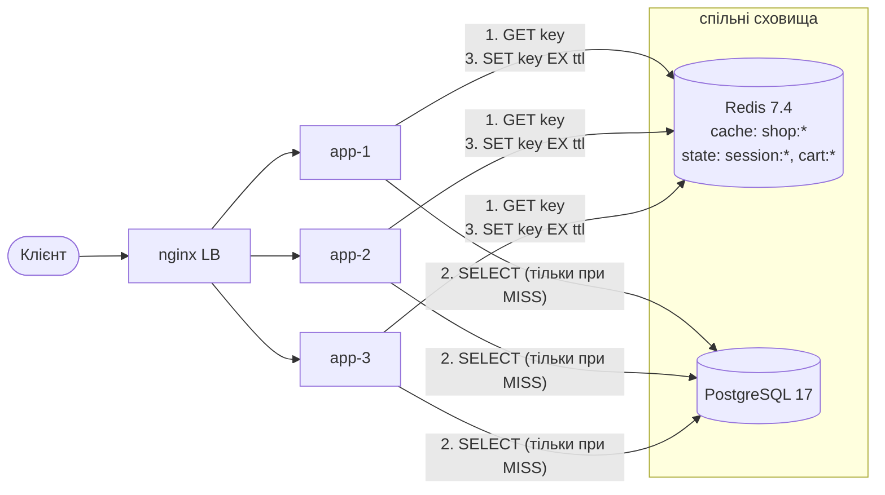

# ЛР № 4 — Distributed Caching (Cache-Aside)

## 1. Вибір об'єктів кешування

| Endpoint | Читання : запис | Допустиме застарівання | Вартість запиту в БД | Рішення |
|---|---|---|---|---|
| `GET /api/stats/top-products` | ~1000 : 0 (результат змінює кожне замовлення, але точність до секунд не потрібна) | 30 с | **висока**: `Seq Scan` + `GROUP BY` по ~150k рядків `order_items`, ≈25–30 мс CPU БД | **кешувати**, TTL 30 с, без явної інвалідації |
| `GET /api/products/{id}` | дуже високе (головний read-сценарій розпродажу, розподіл Ципфа) | ціна й назва мають оновлюватися одразу після редагування | низька (PK lookup), але найчастіший запит | **кешувати**, TTL 5 хв + інвалідація при PUT/DELETE і після checkout |
| `GET /api/products?categoryId&page&size` | високе | до 60 с для залишків (`stock`), але редагування товару має з'являтися одразу | середня (`Index Scan` + `OFFSET`) | **кешувати**, TTL 60 с + інвалідація версією категорії |
| `GET /api/categories` | майже лише читання | 1 год | низька | кешувати, TTL 1 год |
| `GET /api/orders/my`, `/orders/{id}` | персональні дані, читає лише власник | ні: користувач має бачити своє замовлення одразу | середня | **не кешувати**: низький hit rate (кожен ключ читає одна людина) і вимога свіжості |
| `POST /api/orders`, кошик, сесії | запис | — | — | не кеш (сесії й кошик — це вже Redis як primary store, ЛР2) |

Головний принцип: кешувати лише дані, які часто читають багато користувачів і які дорого обчислювати, і лише якщо бізнес допускає їх застарівання на час TTL.

## 2. Архітектура



Redis — окремий контейнер у спільній мережі `backend`. Усі інстанси працюють з одним і тим самим кешем, тому після інвалідації жоден інстанс не віддає застарілу версію (на відміну від локального кешу категорій у ЛР1).

## 3. Реалізація Cache-Aside

[`CacheClient.getOrLoad`](../src/main/java/ua/highload/shop/cache/CacheClient.java):

```
value = GET key                     # Key Lookup
if value != null → return (HIT)     # Cache Hit — БД не чіпаємо
value = loader()                    # Cache Miss — читання з PostgreSQL
SET key json(value) EX ttl          # збереження з TTL
return (MISS)
```

Значення серіалізуються в JSON (Jackson). Пошкоджений запис трактується як MISS. Кожен результат рахується в Micrometer-метриці `shop.cache{result=hit|miss|error|invalidation}` (`/actuator/metrics/shop.cache`). Джерело даних видно в заголовку відповіді **`X-Cache: HIT | MISS | BYPASS`**.

## 4. Схема ключів і TTL

Шаблон: `shop:<entity>:v<schema>:<ідентифікатор і параметри>` ([`CacheKeys`](../src/main/java/ua/highload/shop/cache/CacheKeys.java)).

| Ключ | Приклад | TTL | Обґрунтування |
|---|---|---|---|
| `shop:product:v1:{id}` | `shop:product:v1:42` | 5 хв | є явна інвалідація, TTL лише страхує від пропущеної інвалідації |
| `shop:catalog:v1:{cat\|all}:ver{N}:p{page}:s{size}` | `shop:catalog:v1:3:ver4:p0:s20` | 60 с | у ключі **всі** параметри запиту (категорія, сторінка, розмір), тож колізій немає; `ver{N}` — версія категорії |
| `shop:catalog:ver:{cat\|all}` | `shop:catalog:ver:3` → `4` | без TTL | лічильник версій для групової інвалідації |
| `shop:categories:v1` | — | 1 год | довідник змінюється вкрай рідко |
| `shop:stats:top-products:v1:limit{N}` | `shop:stats:top-products:v1:limit10` | 30 с | аналітика, допустиме застарівання |

* Префікс `shop:` відокремлює кеш від стану `session:*` і `cart:*` в тому самому Redis.
* `v1` — версія **формату** значення. Якщо формат зміниться (наприклад, додасться поле), новий код читатиме `v2`, а старі ключі просто вигаснуть за TTL. Rolling deploy без «отруєння» кешу.

## 5. Інвалідація

| Операція | Що інвалідується | Механізм |
|---|---|---|
| `PUT /api/products/{id}` | картка товару; сторінки каталогу старої **і** нової категорії та `all` | `DEL shop:product:v1:{id}` + `INCR shop:catalog:ver:{cat}` |
| `DELETE /api/products/{id}` | те саме | те саме |
| `POST /api/products` | сторінки каталогу категорії та `all` | `INCR` версії |
| `POST /api/orders` (змінився `stock`) | картки куплених товарів | `DEL` **після COMMIT** (`TransactionSynchronization.afterCommit`): якщо транзакцію відкотять, кеш не чіпаємо |

**Чому версія, а не `DEL` за шаблоном?** Сторінок каталогу дуже багато (категорія × page × size). `KEYS` і `SCAN` за шаблоном мають складність O(N) по всьому keyspace і блокують Redis. `INCR` версії — це O(1): нові запити будують ключ з новою версією і отримують MISS, а старі сторінки ніхто більше не читає, і вони вигасають за TTL.

**Чому `DEL`, а не перезапис нового значення?** Delete-on-write простіший і не створює гонки «два паралельні PUT записують у кеш у різному порядку». Наступне читання гарантовано підтягне свіжі дані з БД.

## 6. Результати

Повний вивід: [`results/lab04/cache-demo.txt`](../results/lab04/cache-demo.txt) (`scripts/lab4-cache-demo.sh`).

### 6.1 HIT / MISS / інвалідація

```
### 1. MISS → HIT (картка товару 42)
200  X-Cache=MISS   app-3  t=3.8 ms
200  X-Cache=HIT    app-1  t=2.7 ms      ← інший інстанс, той самий кеш
200  X-Cache=HIT    app-2  t=3.7 ms
TTL ключа: 300 с
### 2. Інвалідація при PUT
PUT -> 200
200  X-Cache=MISS   app-2                ← свіжі дані з БД
200  X-Cache=HIT    app-3
### 3. Інвалідація сторінок каталогу через версію категорії
200  X-Cache=MISS / HIT ; PUT ; версія категорії 3: 2 → наступний запит MISS
```

### 6.2 Cold vs Hot

20 вимірювань кожного варіанта, curl через nginx:

| Запит | Cold (MISS), медіана | Hot (HIT), медіана | Прискорення |
|---|---|---|---|
| `GET /api/stats/top-products` | **28.96 мс** (min 23.97, max 38.63) | **2.35 мс** (min 1.66, max 10.56) | **≈12×** |
| `GET /api/products/{id}` | ≈3.5–3.8 мс | ≈1.5–3.7 мс | ≈1.5× |

Для PK lookup кеш майже не скорочує латентність одного запиту: PostgreSQL відповідає з shared buffers за ~0.2 мс, і час іде в основному на HTTP, JSON і мережу. Кешування дешевих запитів знімає **навантаження з БД**: кожен HIT — це запит, який не займає з'єднання з пулу і не витрачає CPU БД. Кількісний ефект під навантаженням виміряно в ЛР5 (Cache Enabled vs Disabled).

### 6.3 Hit ratio під навантаженням

Лічильники `shop.cache` після прогріву (30 с, 50 VUs, `GET /api/products/{id}`):

| Інстанс | hit | miss | Hit ratio |
|---|---|---|---|
| app-1 | 14 775 | 122 | 99.2 % |
| app-2 | 14 771 | 128 | 99.1 % |
| app-3 | 14 795 | 103 | 99.3 % |

У кеші 9 994 ключі `shop:product:v1:*` (≈10k товарів × ~1 KB ≈ 10 MB). Увесь каталог вміщується в пам'ять Redis, тож eviction не потрібен. `maxmemory-policy` стає важливою, коли «гарячий» набір даних більший за пам'ять (див. питання до захисту).

## 7. Fallback: відмова Redis

`podman stop shop_redis_1`:

| Запит | Результат | Пояснення |
|---|---|---|
| `GET /api/products/42` | **200, `X-Cache: BYPASS`**, 3–4 мс | читання напряму з PostgreSQL |
| `GET /api/products?categoryId=3` | **200, BYPASS** | |
| `GET /api/stats/top-products` | **200, BYPASS**, 26 мс | працює, але кожен запит знову агрегує 150k рядків |
| `GET /health` | **200, `"status":"DEGRADED"`** | вузол лишається в пулі балансувальника |
| `POST /api/auth/login` | **503 «Session store temporarily unavailable»** | сесії живуть лише в Redis, тож це контрольована деградація замість 500 |

Механізми graceful degradation:

1. **Будь-яка помилка Redis у `CacheClient`** перехоплюється, і дані читаються з БД (BYPASS).
2. **Circuit breaker (5 с):** після першої помилки кеш вважається недоступним 5 с, і запити йдуть одразу в БД. Без нього кожен запит чекав би таймауту Redis (500 мс) і p99 виріс би до 500+ мс.
3. **Lettuce `DisconnectedBehavior.REJECT_COMMANDS`:** коли з'єднання розірване, команди відхиляються миттєво, а не стоять у черзі до таймауту.
4. **`/health`:** Redis — некритична залежність, тому статус `DEGRADED` повертається з кодом 200. Інакше активний health check вивів би з пулу **всі** вузли разом.
5. **Інвалідація при недоступному Redis:** `evict` логує помилку. Якщо саме в цей момент Redis «моргнув», дані можуть бути застарілими не довше TTL. Це свідомий компроміс, і саме тому TTL не може бути нескінченним.

Після `podman start shop_redis_1` інстанси автоматично перепідключаються. Lettuce повторює спроби з exponential backoff, і кеш знову активний через ≈20 с без рестарту застосунку.

**Ризик (див. ЛР8):** на холодному кеші після рестарту Redis усі запити одночасно стають MISS і потрапляють у БД. Це Cache Stampede / Thundering Herd.

## 8. Питання до захисту

* **Cache Stampede / Thundering Herd:** популярний ключ вигасає, і сотні паралельних запитів одночасно отримують MISS та виконують той самий дорогий запит у БД. Захист: mutex або single-flight, stale-while-revalidate, probabilistic early expiration (ЛР8).
* **Cache Avalanche:** багато ключів вигасає одночасно (однаковий TTL після масового прогріву) або падає весь Redis, і на БД приходить лавина. Захист: TTL jitter, реплікація або кластер Redis, circuit breaker і rate limiting у БД.
* **Cache Penetration:** запити до неіснуючих id ніколи не потрапляють у кеш і завжди йдуть у БД. Захист: negative caching, Bloom filter (ЛР8).
* **Eviction:** **LRU** витісняє те, що найдовше не читали, і підходить для більшості кешів. **LFU** витісняє те, що читають найрідше, і краще тримає стабільно популярні ключі (наш топ товарів за Ципфом). У Redis це `maxmemory-policy allkeys-lru | allkeys-lfu | volatile-*`. Для змішаного Redis (кеш + сесії) потрібна `volatile-lru`, щоб не витісняти сесії; кращий варіант — окремий інстанс Redis для кешу.
* **Expiration vs Invalidation:** expiration — пасивне вигасання за TTL, гарантує свіжість лише «не гірше TTL». Invalidation — активне видалення при зміні даних, дає свіжість одразу, але потребує, щоб кожен шлях запису знав, які ключі зачіпає. Ми використовуємо обидва механізми: інвалідацію для коректності, TTL як страховку.
* **Чому не кешуємо замовлення користувача?** Hit rate низький (кожен ключ читає одна людина), а вимога консистентності висока (read-your-own-writes, ЛР6).
