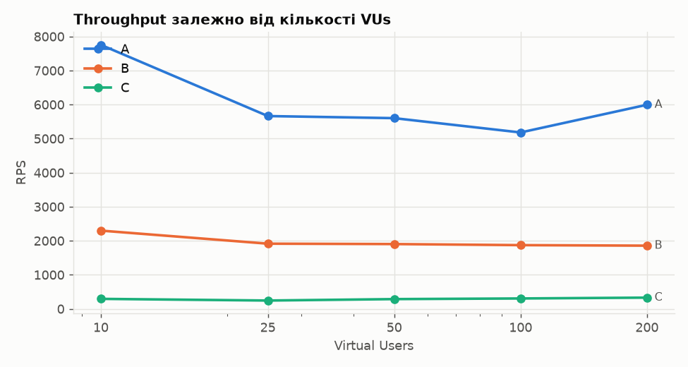
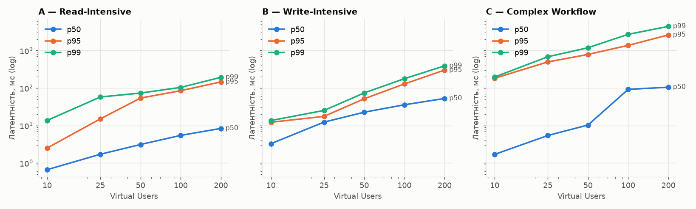
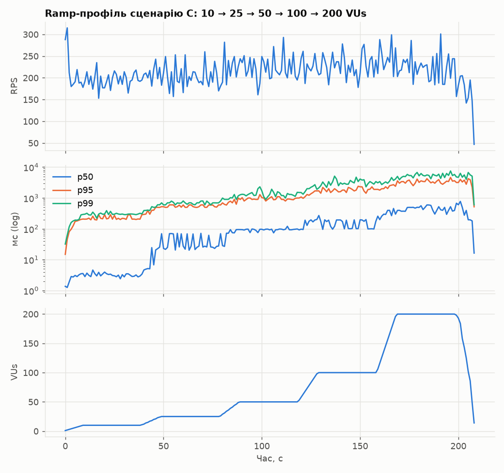
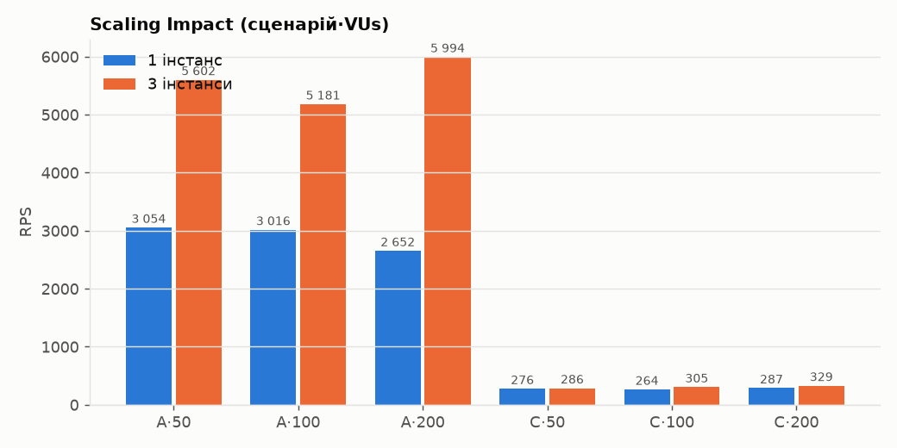
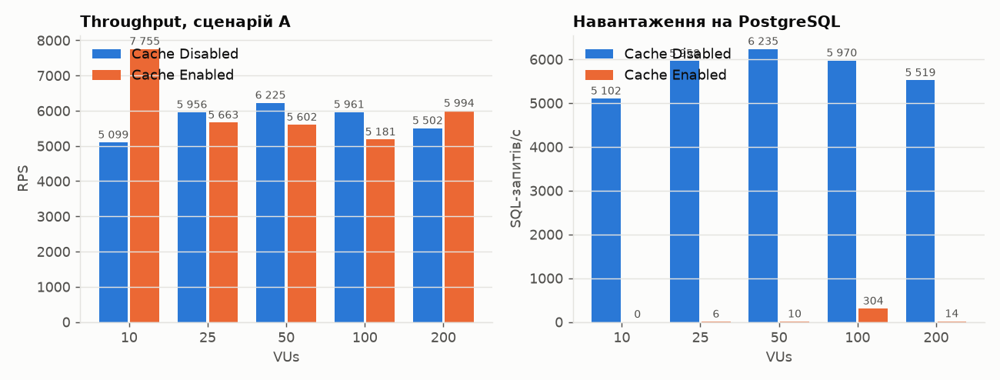

# ЛР № 5 — Load & Performance Baseline

## 1. Сценарії навантаження

Скрипти: [`load-tests/scenarios.js`](../load-tests/scenarios.js) (k6), спільні утиліти — [`load-tests/lib/common.js`](../load-tests/lib/common.js).

| Сценарій | Тип | Опис | Ресурсний профіль |
|---|---|---|---|
| **A** | Read-Intensive | 80 % `GET /api/products/{id}` (id за степеневим розподілом, як у seed-даних: популярні товари частіші) + 20 % `GET /api/products?categoryId&page` | Redis (cache-aside), CPU застосунку (JSON), мережа |
| **B** | Write-Intensive | `POST /api/orders` з 1–3 випадковими товарами; кожен VU — окремий залогінений користувач | транзакції PostgreSQL: `SELECT … FOR UPDATE`, `UPDATE stock`, `INSERT`, `COMMIT` (WAL fsync) |
| **C** | Complex Workflow | каталог → картка товару → `POST /cart/items` → checkout з кошика → `GET /orders/my` (історія) | змішаний: Redis (сесія, кошик, кеш) + транзакція + читання історії |

Ручні вимірювання Postman/curl не використовуються. Для B/C у `setup()` логіниться пул із 1000 seed-користувачів (`user1..1000@shop.test`).

## 2. Тестове середовище

Автоматично зафіксована специфікація: [`results/lab05/environment.md`](../results/lab05/environment.md).

| Параметр | Значення |
|---|---|
| Хост | Intel i5-12500H (4P + 8E ядер, 16 потоків), 16 GB RAM, NVMe, Fedora (kernel 7.2), rootless podman 5.8 |
| Backend | 3 × Spring Boot (Java 21, G1), **1 CPU / 768 MB** кожен; Tomcat 200 потоків; HikariCP 10 з'єднань на інстанс |
| Load Balancer | nginx 1.27, Round Robin, keepalive 64, 1 CPU |
| PostgreSQL | 17.11, **2 CPU / 1 GB**, `shared_buffers=256MB`, `max_connections=200`, `pg_stat_statements` |
| Redis | 7.4, 1 CPU, AOF everysec; кеш **увімкнено** (TTL: товар 5 хв, каталог 60 с) |
| Load Generator | k6 2.3, прив'язаний до CPU 12–15 (`taskset`) |
| Дані на старті | 10k товарів, 2k користувачів, 103k замовлень, 203k позицій |

**Ізоляція LG і SUT.** k6 прив'язаний до окремих ядер, а SUT обмежений квотами cgroup (`cpus`), тож генератор не може «з'їсти» CPU системи. Повної ізоляції немає: rootless podman не делегує `cpuset`, тому контейнери можуть виконуватися на будь-яких ядрах, і обидві сторони ділять L3-кеш і пам'ять. Для 3–4 ядер SUT і 4 ядер k6 на 16-потоковому хості цього достатньо: під час тестів k6 використовував менше 2 ядер.

**Метрики ресурсів** знімаються з cgroup `cpu.stat` (дельта `usage_usec` за час прогону, в ядрах). `podman stats --no-stream` показує середнє за весь час життя контейнера і для цього не підходить. Навантаження на БД рахується як дельта `sum(calls)` у `pg_stat_statements` (SQL-запитів за секунду).

## 3. Профіль навантаження та Warm-up

* **Warm-up:** 180 с змішаного читання перед серією, плюс 20 с самого сценарію перед його першим ступенем. Прогрів критичний. Під час ЛР3 виявилось, що при квоті в 1 CPU JIT-компілятор C2 конкурує з потоками запитів і компілює гарячий код **кілька хвилин**. Без прогріву той самий тест давав 2.2k → 3.9k → 9.1k RPS у трьох прогонах поспіль, а у свіжої JVM потік `C2 CompilerThread` був найзавантаженішим.
* **Staging:** 10 → 25 → 50 → 100 → 200 VUs, кожен ступінь — окремий прогін `constant-vus` по 30 с (метрики кожного ступеня не змішуються). Додатково виконано безперервний ramp (`ramping-vus`: 10 с наростання + 30 с утримання кожного ступеня) для графіка в часі.
* Модель — **замкнена** (closed): кожен VU відправляє наступний запит лише після відповіді на попередній, без think time. Це максимальний тиск на систему. Наслідки для вимірювань описані в розділі 7.

Запуск: `scripts/lab5-baseline.sh` (≈50 хв), таблиці й графіки: `python3 scripts/plot_lab5.py`.

## 4. Результати

### 4.1 Сценарій A — Read-Intensive

| VUs | Throughput (RPS) | Avg, мс | p50, мс | p95, мс | p99, мс | Error Rate | SQL/с | CPU app Σ / PG, ядер |
|---|---|---|---|---|---|---|---|---|
| 10 | **7 755** | 1.2 | 0.7 | 2.5 | 13.7 | 0 % | ~0 | 2.92 / 0.01 |
| 25 | 5 663 | 4.3 | 1.7 | 15.0 | 57.5 | 0 % | 6 | 2.75 / 0.03 |
| 50 | 5 602 | 8.7 | 3.1 | 53.9 | 73.4 | 0 % | 10 | 2.74 / 0.02 |
| 100 | 5 181 | 19.1 | 5.5 | 84.8 | 103.7 | 0 % | 304 | 2.69 / 0.07 |
| 200 | 5 994 | 33.1 | 8.4 | 145.4 | 192.9 | 0 % | 14 | 2.74 / 0.02 |

### 4.2 Сценарій B — Write-Intensive

| VUs | Throughput (RPS) | Avg, мс | p50, мс | p95, мс | p99, мс | Error Rate | SQL/с | CPU app Σ / PG, ядер |
|---|---|---|---|---|---|---|---|---|
| 10 | **2 298** | 4.2 | 3.3 | 12.2 | 13.6 | 0 % | 26 527 | 1.73 / 1.23 |
| 25 | 1 914 | 12.8 | 12.3 | 17.5 | 25.2 | 0 % | 22 751 | 2.10 / 1.73 |
| 50 | 1 903 | 25.8 | 22.6 | 51.7 | 74.1 | 0 % | 21 941 | 2.41 / 1.80 |
| 100 | 1 871 | 52.8 | 35.7 | 128.5 | 177.4 | 0 % | 21 560 | 2.41 / 1.81 |
| 200 | 1 856 | 106.6 | 52.7 | 300.8 | 389.5 | 0 % | 21 427 | 2.38 / 1.80 |

### 4.3 Сценарій C — Complex Workflow

| VUs | Throughput (RPS) | Avg, мс | p50, мс | p95, мс | p99, мс | Error Rate | SQL/с | CPU app Σ / PG, ядер |
|---|---|---|---|---|---|---|---|---|
| 10 | 293 | 33.9 | 1.7 | 182.2 | 196.4 | 0 % | 1 043 | 0.28 / **1.95** |
| 25 | 244 | 101.4 | 5.4 | 495.3 | 679.7 | 0 % | 835 | 0.30 / 1.90 |
| 50 | 286 | 172.8 | 10.3 | 784.6 | 1 184.6 | 0 % | 1 033 | 0.33 / 1.98 |
| 100 | 305 | 321.1 | 92.0 | 1 369.7 | 2 696.5 | 0 % | 1 100 | 0.29 / 1.96 |
| 200 | 329 | 586.4 | 105.1 | 2 601.1 | **4 392.9** | **0.38 %** | 1 161 | 0.45 / 1.90 |

Один workflow складається з 5 HTTP-запитів, тобто 300 RPS ≈ 60 оформлених покупок за секунду.

### 4.4 Графіки







На ramp-графіку сценарію C throughput **не росте** вже з першого ступеня (~200 RPS), а p50/p95/p99 піднімаються сходинками разом з кожним ступенем VUs. Система насичена з самого початку, і кожен новий VU лише подовжує чергу.

## 5. Аналіз розподілу латентності: середнє vs хвіст

* **Середнє приховує хвіст.** У C при 100 VUs avg = 321 мс, але p99 = 2.7 с, тобто 1 % запитів у 8 разів повільніший за середній. p50 = 92 мс: «типовий» користувач не бачить проблеми, а кожен сотий чекає майже 3 с. Користувач, який робить 5 запитів за workflow, натрапить хоча б на один p99-запит з імовірністю 1 − 0.99⁵ ≈ 5 %.
* **Бімодальний розподіл у C:** p50 = 1.7 мс, а p95 = 182 мс уже при 10 VUs. Швидкі запити (кеш, Redis) і повільні (`GET /orders/my`) — це два різні класи, і перцентилі показують саме повільний клас.
* **Чому хвіст росте нелінійно.** За законом Літтла `N = λ · W`: коли λ (throughput) упирається в стелю, усе додаткове N (VUs) перетворюється на W (час відповіді): `W = N / λ`. Перевірка для A при 200 VUs: 200 / 5 994 ≈ 33 мс, і виміряне avg = 33.1 мс. Хвіст росте швидше за середнє, бо черга нерівномірна:
  * **CFS throttling:** контейнер з 1 CPU, який вичерпав квоту на 100-мілісекундний період, заморожується до кінця періоду. Звідси «полиця» p95/p99 ≈ 85–105 мс в A при 100 VUs і в ЛР3.
  * **Черга до пулу з'єднань** (Hikari, 10 на інстанс): запит, що чекає з'єднання, стоїть у FIFO за всіма попередніми.
  * **Блокування рядків** у B: замовлення популярних товарів серіалізуються на `FOR UPDATE`.
  * **GC-паузи** G1 і JIT-деоптимізації (поодинокі `max` 300–800 мс).
  * У C повільні запити тримають з'єднання з пулу сотні мілісекунд і блокують за собою навіть швидкі запити.

## 6. Saturation Point та первинний Bottleneck

| Сценарій | Saturation Point | Stable Throughput | Первинний bottleneck | Доказ |
|---|---|---|---|---|
| A | **≤ 10 VUs** | ~5.6–7.7k RPS | **CPU backend-інстансів** (3 × 1 CPU) | app 2.7–2.9 з 3 ядер, PostgreSQL ≈ 0 (кеш віддає ~99.9 % читань), throughput не росте з VUs, avg = N/λ |
| B | **~10–25 VUs** | ~1.9k замовлень/с | **PostgreSQL write path** (CPU + WAL) | PG 1.8 з 2 ядер з 25 VUs; ~11 SQL на замовлення (lock, N×update, insert order, batch items, commit) |
| C | **≤ 10 VUs** | ~300 RPS (~60 workflow/с) | **PostgreSQL CPU — запит історії замовлень** | PG 1.95 з 2 ядер, app 0.3 (простоюють); див. нижче |

Топ запитів за сумарним часом виконання ([`results/lab05/pg_stat_statements-top.txt`](../results/lab05/pg_stat_statements-top.txt)):

```
 total_s | pct  |  calls  | mean_ms | query
  6451.6 | 95.8 |   22829 | 282.603 | SELECT id, user_id, status, total_cents, created_at FROM orders WHERE user_id = $1 ORDER B…
    65.1 |  1.0 |  659145 |   0.099 | INSERT INTO order_items …
    37.7 |  0.6 |  659145 |   0.057 | UPDATE products SET stock = stock - $1 …
```

**Висновок:** первинне вузьке місце системи — `GET /api/orders/my`. Запит `orders WHERE user_id = ?` займає **95.8 % усього часу БД** при середньому часі **283 мс**: на `orders.user_id` немає індексу (гіпотеза №3 з ЛР1), тож кожен виклик робить `Seq Scan` по всій таблиці. Додатково N+1 дає ще 1 запит на кожне замовлення. Детальна діагностика й виправлення — у ЛР9.

**Важливе зауваження щодо даних.** Сценарій B за серію записав ~340k замовлень, і таблиця `orders` виросла зі 103k до 443k рядків. Сценарій C виконувався **після** B, тому повний скан ставав дорожчим із кожним ступенем. Це прямо демонструє проблему, адже латентність запиту без індексу росте лінійно з обсягом даних. Для порівнянь у наступних ЛР дані перед кожною серією скидаються до seed-стану ([`scripts/reset-data.sh`](../scripts/reset-data.sh)).

## 7. Контрольні експерименти

### 7.1 Scaling Impact — 1 vs 3 інстанси

Пул балансувальника звужується до одного вузла (`upstream-scale-1.conf`), а всі JVM лишаються прогрітими.

| Сценарій | VUs | RPS, 1 інстанс | RPS, 3 інстанси | Speedup | Scalability Efficiency | p95 1 → 3, мс | p99 1 → 3, мс |
|---|---|---|---|---|---|---|---|
| A | 50 | 3 054 | 5 602 | 1.83× | 61 % | 86.1 → 53.9 | 93.2 → 73.4 |
| A | 100 | 3 016 | 5 181 | 1.72× | 57 % | 96.3 → 84.8 | 100.6 → 103.7 |
| A | 200 | 2 652 | 5 994 | 2.26× | 75 % | 161.6 → 145.4 | 198.2 → 192.9 |
| C | 50 | 276 | 286 | 1.04× | 35 % | 889.5 → 784.6 | 1 393.8 → 1 184.6 |
| C | 100 | 264 | 305 | 1.16× | 39 % | 1 795.9 → 1 369.7 | 3 093.1 → 2 696.5 |
| C | 200 | 287 | 329 | 1.15× | 38 % | 3 010.5 → 2 601.1 | 4 896.7 → 4 392.9 |



`Scalability Efficiency = Speedup / N`.

* **A** масштабується з ефективністю 57–75 %, бо bottleneck — CPU застосунку. Ефективність нижча за 100 %: зі збільшенням трафіку nginx (0.5 ядра) і Redis також навантажуються, плюс шум гібридного CPU.
* **C** майже **не масштабується** (1.04–1.16×). Вузьке місце — БД, а її в усіх конфігураціях одна. Додавати інстанси застосунку сенсу немає, поки не прибрано bottleneck у БД (індекс — ЛР9, read replicas — ЛР6, шардинг — ЛР7).

### 7.2 Caching Impact — Cache Disabled vs Enabled (сценарій A)

`CACHE_ENABLED=false` → рестарт інстансів → 180 с прогріву.

| VUs | RPS без кешу | RPS з кешем | p95 без / з, мс | p99 без / з, мс | SQL/с без кешу | SQL/с з кешем | CPU PG без / з |
|---|---|---|---|---|---|---|---|
| 10 | 5 099 | 7 755 | 3.5 / 2.5 | 30.8 / 13.7 | 5 102 | ~0 | 0.61 / 0.01 |
| 25 | 5 956 | 5 663 | 23.2 / 15.0 | 38.6 / 57.5 | 5 958 | 6 | 0.88 / 0.03 |
| 50 | 6 225 | 5 602 | 38.8 / 53.9 | 62.9 / 73.4 | 6 235 | 10 | 0.93 / 0.02 |
| 100 | 5 961 | 5 181 | 81.2 / 84.8 | 101.2 / 103.7 | 5 970 | 304 | 0.89 / 0.07 |
| 200 | 5 502 | 5 994 | 181.1 / 145.4 | 346.7 / 192.9 | 5 519 | 14 | 0.83 / 0.02 |



Чесний висновок:

* **Навантаження на СУБД падає на ~99.8 %**: з ~6 000 SQL/с і ~0.9 ядра PostgreSQL до ~10 SQL/с і ~0.02 ядра. Саме це головний ефект кешу: БД звільняється під запис (B) та історію замовлень (C).
* **Throughput сценарію A від кешу майже не змінився** (у межах шуму ±15 %). Bottleneck сценарію A — CPU застосунку, а cache HIT коштує інстансу приблизно стільки ж CPU, скільки PK-запит у PostgreSQL: `GET` у Redis + десеріалізація JSON → `Product` + повторна серіалізація у відповідь. Гіпотеза для ЛР9: віддавати закешований JSON без повторної (де)серіалізації.
* **Хвіст при 200 VUs кращий з кешем** (p99 193 проти 347 мс): без кешу запити стоять ще й у черзі до пулу з'єднань БД.

**Cold vs Warm cache** (A, 100 VUs, 10 с, одразу після очищення `shop:*`): cold — 2 419 RPS, 713 SQL/с, p99 191 мс; warm — 3 133 RPS, 217 SQL/с, p99 164 мс. Холодний кеш створює сплеск звернень до БД (кожен ключ уперше — MISS); при дорогих запитах він переростає у Cache Stampede (ЛР8). Обидва прогони короткі й виконані одразу після рестарту JVM, тож абсолютні RPS нижчі за основну серію.

## 8. Coordinated Omission: closed vs open model

1 інстанс, сценарій A. Closed model — 200 VUs. Open model (`constant-arrival-rate`, [`load-tests/open-model.js`](../load-tests/open-model.js)) — 3 132 запити/с, тобто 120 % від пропускної здатності, виміряної closed-моделлю.

| Модель | RPS | p50, мс | p95, мс | p99, мс | max | Dropped iterations |
|---|---|---|---|---|---|---|
| Closed (200 VUs) | 2 611 | 92.2 | 188.0 | 200.0 | 403 мс | — |
| Open (3 132/с) | 3 053 | 0.6 | **295.8** | **410.2** | 1 с | **2 126** (k6 не встиг відправити вчасно) |

У замкненій моделі повільна система сама сповільнює генератор: VU не відправить новий запит, поки не дочекається старого, тож запити, які мали б прийти саме під час «гальмування», **не відправляються і не вимірюються**. Це і є **Coordinated Omission**: генератор «домовляється» з системою, і хвіст латентності виглядає кращим, ніж його побачать реальні користувачі, які приходять незалежно один від одного. Відкрита модель тримає швидкість надходження фіксованою, і p99 виявився в **2 рази гіршим** (410 проти 200 мс), а 2 126 запитів k6 не встиг навіть відправити. Тому для SLA-вимірювань потрібна відкрита модель (`constant-arrival-rate`) або корекція CO (HdrHistogram з expected interval).

## 9. System Performance Baseline

```
=== SYSTEM PERFORMANCE BASELINE ===
Environment Config: 3 × app (1 CPU / 768 MB, Java 21 G1, Tomcat 200, Hikari 10), nginx RR,
                    PostgreSQL 17 (2 CPU / 1 GB, single node), Redis 7.4 (cache ON); i5-12500H, NVMe
Stable Throughput:  A (read)  ≈ 5 600 RPS  (p95 54 ms @ 50 VUs)
                    B (write) ≈ 1 900 orders/s (p95 52 ms @ 50 VUs)
                    C (mixed) ≈ 300 RPS ≈ 60 workflows/s (p95 182 ms @ 10 VUs)
Saturation Point:   A ≤ 10 VUs, B ≈ 10–25 VUs, C ≤ 10 VUs (throughput flat далі, latency = N/λ)
p95 / p99 Latency:  A 53.9 / 73.4 ms @ 50 VUs;  B 51.7 / 74.1 ms @ 50 VUs;  C 182 / 196 ms @ 10 VUs
Error Rate:         0 % для A/B на всіх ступенях; C — 0.38 % @ 200 VUs (таймаути, p99 4.4 s)
Critical Scenario:  C — Complex Workflow (GET /api/orders/my)
Primary Bottleneck: PostgreSQL CPU: Seq Scan orders WHERE user_id (немає індексу) + N+1 —
                    95.8 % часу БД, 283 ms/виклик; для read-сценарію — CPU backend (3 × 1 CPU)
```

## 10. Питання до захисту

* **p50 vs p99.** Медіана описує типовий досвід, p99 — найгірший досвід кожного сотого запиту. При фан-ауті (сторінка робить N запитів) хвіст визначає досвід майже кожного користувача, тому SLO формулюють за p95 або p99, а не за середнім.
* **Saturation Point** — момент, після якого throughput перестає рости зі збільшенням навантаження, а латентність і помилки починають рости швидко (за законом Літтла вся додаткова конкурентність іде в чергу). На графіках це «коліно» кривої throughput і злам кривої p99.
* **Coordinated Omission** — див. розділ 8.
* **Вплив GC і JIT на перцентилі.** JIT: перші хвилини після старту код інтерпретується або компілюється C1, а C2-компіляція з'їдає CPU, тому прогрів обов'язковий (у нас при 1 CPU він триває кілька хвилин). GC: stop-the-world паузи G1 (зазвичай 5–50 мс) зупиняють усі потоки, і всі запити в польоті отримують однакову додаткову затримку. На p50 це майже не видно, але це формує p99 і `max`. Великий allocation rate (наприклад, JSON-серіалізація) частішає Young GC.
