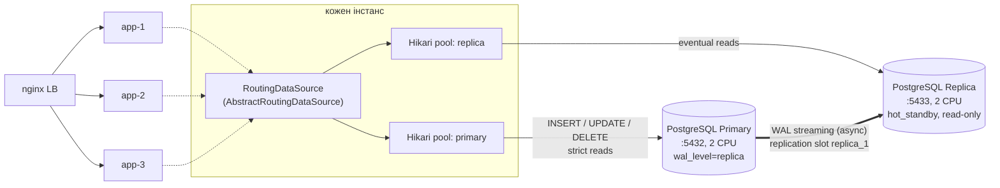

# ЛР № 6 — Database Replication та Read/Write Separation

## 1. Топологія реплікації



| Вузол | Роль | Конфігурація |
|---|---|---|
| `postgres` (Primary) | приймає всі мутації (INSERT/UPDATE/DELETE/DDL) і строгі читання | `wal_level=replica`, `max_wal_senders=10`, `max_replication_slots=10`, власний [`db/pg_hba.conf`](../db/pg_hba.conf) з рядком `host replication replicator all scram-sha-256`, роль `replicator` (міграція [`V4__replication_role.sql`](../src/main/resources/db/migration/V4__replication_role.sql)) |
| `postgres-replica` | Hot Standby, read-only | [`db/replica-entrypoint.sh`](../db/replica-entrypoint.sh): при порожньому томі — `pg_basebackup -R -X stream -C -S replica_1` (повна копія + `standby.signal` + `primary_conninfo` + фізичний replication slot), далі безперервне програвання WAL; `hot_standby_feedback=on` |

Реплікація **фізична** (побайтова копія WAL) і **асинхронна**: Primary підтверджує `COMMIT`, не чекаючи репліки. Replication slot гарантує, що Primary не видалить WAL, поки репліка його не забрала (наприклад, коли вона лежить), тож після рестарту репліка наздоганяє без повторного `pg_basebackup`.

### Перевірка реплікації

Вивід [`scripts/lab6-demo.sh`](../scripts/lab6-demo.sh), повністю — [`results/lab06/demo.txt`](../results/lab06/demo.txt):

```
### 1. Реплікація: запис через API → Primary, перевірка наявності на Replica
primary: 10003|Replicated product
replica: 10003|Replicated product
replica pg_is_in_recovery: t
запис на replica: ERROR:  cannot execute UPDATE in a read-only transaction
 application_name |   state   | sync_state |  sent_lsn  | replay_lsn |   replay_lag
 walreceiver      | streaming | async      | 0/2B030CC0 | 0/2B030CC0 | 00:00:00.000964
```

Діагностичний endpoint `GET /api/admin/replication` повертає `pg_stat_replication` з Primary, LSN-позиції Replica і поточний стан маршрутизації.

## 2. Read/Write Separation

Реалізація програмна, у Data Access Layer (пакет [`db`](../src/main/java/ua/highload/shop/db/)):

* [`RoutingDataSource`](../src/main/java/ua/highload/shop/db/RoutingDataSource.java) extends `AbstractRoutingDataSource` — два пули HikariCP (Primary, Replica) за одним `DataSource`, тож `JdbcTemplate`, Flyway і транзакції працюють як раніше.
* [`DbRouting`](../src/main/java/ua/highload/shop/db/DbRouting.java) — `ThreadLocal`-контекст і явні обгортки `DbRouting.replica(() -> …)` та `DbRouting.primary(() -> …)`. **За замовчуванням усе йде на Primary**: забута анотація призводить до зайвого навантаження на Primary, а не до застарілих даних.
* Транзакції (`@Transactional`, checkout) завжди на Primary: з'єднання береться на початку транзакції, коли контекст = PRIMARY.
* Заголовок відповіді **`X-DB-Node: primary | replica | primary-fallback`** показує, який вузол обслужив запит.

## 3. Класифікація читань

| Операція | Клас | Маршрут | Обґрунтування |
|---|---|---|---|
| каталог, картка товару (MISS кешу), категорії | Eventual | **Replica** | секунди затримки нікому не шкодять; найбільший read-трафік |
| `GET /api/stats/top-products` | Eventual | **Replica** | аналітика, і так кешується на 30 с |
| `GET /api/users/{id}` (публічний профіль) | Eventual | **Replica** | |
| `GET /api/orders/my` | **Read-Your-Own-Writes** | Replica; **Primary** протягом 5 с після власного запису | користувач має бачити щойно оформлене замовлення |
| `GET /api/orders/{id}` (підтвердження) | **Strong** | **Primary** (explicit) | сторінка «дякуємо за замовлення» відкривається одразу після `POST` |
| `POST /api/auth/login` (облікові дані), `GET /api/users/me` | **Strong** | **Primary** (explicit) | щойно зареєстрований користувач мусить одразу увійти |
| checkout: залишок на складі | **Strong** (транзакція) | **Primary** + `SELECT … FOR UPDATE` | гроші й склад; рішення не можна приймати за застарілими даними |

## 4. Replication Lag і Stale Read

Лаг відтворюється синтетично на Replica без рестарту: `ALTER SYSTEM SET recovery_min_apply_delay = '3s'; SELECT pg_reload_conf();`.

```
### 2. Stale Read: штучний лаг recovery_min_apply_delay=3s на Replica
замовлень до запису (primary): 0                       ← щойно зареєстрований користувач
POST /api/orders → 201, X-DB-Node=primary
  GET /orders/my consistency=EVENTUAL → 0 замовлень, X-DB-Node=replica    ← STALE READ
  GET /orders/my consistency=RYW      → 1 замовлень, X-DB-Node=primary    ← захищено
  через 6 с (fence вигас, replica наздогнала): RYW → 1 замовлень, X-DB-Node=replica
```

Параметр `consistency=EVENTUAL|RYW|STRONG` у `GET /api/orders/my` додано для демонстрації (за замовчуванням `RYW`).

Реальний лаг без штучної затримки: `replay_lag` ≈ 1–3 мс у стані спокою. Під навантаженням запису лаг росте, бо одна репліка програє WAL в один потік (startup process).

## 5. Read-After-Write Consistency: Session Sticky Routing (write fence)

Реалізація — Session Sticky Routing з TTL:

1. Після `COMMIT` замовлення (`afterCommit`) застосунок ставить у Redis ключ `shop:fence:user:{userId}` з TTL 5 с (`shop.replica.fence-ttl`, має бути більшим за типовий лаг).
2. `GET /api/orders/my`: якщо fence існує, запит іде на **Primary**, інакше на Replica.
3. Fence живе в Redis, а не в пам'яті інстансу, тож він працює, навіть коли запис і читання обробили різні інстанси (stateless, ЛР2).
4. Якщо Redis недоступний, `fenced()` повертає `true`: краще зайве навантаження на Primary, ніж застарілі дані.

Той самий механізм захищає **кеш від «отруєння»**. Якщо після інвалідації картку товару перечитати з репліки, що відстає, у кеш на 5 хв ляже застаріле значення. Тому:

* `PUT /api/products/{id}` робить **write-through**: свіже значення з Primary одразу записується в кеш.
* після checkout (змінився `stock`) ставиться fence `shop:fence:product:{id}`, і MISS у межах 5 с читає з Primary;
* після зміни каталогу fence на категорію змушує перебудову сторінок читати з Primary.

Альтернативи, що розглядались: **LSN verification** (зберегти `pg_current_wal_lsn()` після запису і читати з репліки лише якщо `pg_last_wal_replay_lsn() >= LSN`) — точніше за TTL, але потребує зберігати LSN для кожного користувача і робити зайвий запит до репліки. **Explicit Primary Routing** — використано для підтвердження замовлення та автентифікації.

## 6. Відмовостійкість

### Втрата Replica — `podman stop shop_postgres-replica_1`

```
GET /orders/my (EVENTUAL) → 200, X-DB-Node=primary-fallback
GET /users/5 → 200, X-DB-Node=primary-fallback
POST /orders → 201
/health → 200 {"status":"DEGRADED", … "replica":{"status":"DOWN","usable":false}}
replica повернулась у ротацію на всіх інстансах через 11 с після старту контейнера
```

**Primary Fallback**: [`ReplicaHealth`](../src/main/java/ua/highload/shop/db/ReplicaHealth.java) щосекунди перевіряє репліку (доступність і лаг: якщо є незастосований WAL, лаг = `now() − pg_last_xact_replay_timestamp()`). Помилка з'єднання одразу позначає її DOWN. Read-запити тоді прозоро йдуть на Primary, а клієнт не бачить жодної помилки. Так само репліка виводиться з ротації, якщо її лаг більший за `shop.replica.max-lag=10s`. Повернення займає ~11 с: PostgreSQL проходить recovery після старту, а Hikari замінює мертві з'єднання в пулі.

### Втрата Primary — `podman stop shop_postgres_1`

```
POST /orders → 503 {"detail":"Primary database unavailable: service is in read-only mode", …}
GET /orders/my (EVENTUAL) → 200, X-DB-Node=replica
GET /users/5 → 200, X-DB-Node=replica
GET /products/123 → 200, X-Cache=HIT
GET /orders/1 (strict, primary) → 503
primary повернувся: POST /orders → 201 (через 0–7 с після старту контейнера)
```

**Read-Only Mode**: мутації та строгі читання отримують контрольований `503` з `"mode":"read-only"`. Пул Primary має `connectionTimeout=1.5s`, тож відмова не «вішає» запит на 30 с. Каталог, профілі та історія (eventual) продовжують працювати з Replica і кешу.

Автоматичного **failover** (підвищення Replica до Primary) у стенді немає. Це свідомий вибір: без кворуму (Patroni + etcd або Raft) автоматичне підвищення ризикує **split-brain** (дві «primary» приймають записи після мережевого розриву). Ручне підвищення: `SELECT pg_promote();` на репліці та перемикання `DB_URL`.

## 7. Read Scaling Impact: Single Primary vs Primary + Replica

Методика: `CACHE_ENABLED=false`, щоб читання справді доходили до СУБД. Перед кожною топологією дані скидаються до seed-стану (`scripts/reset-data.sh`, 50k замовлень), прогрів 180 с, по 30 с на ступінь. Single Primary — це `REPLICA_ENABLED=false` (пул репліки = пул Primary). Скрипт: [`scripts/lab6-benchmark.sh`](../scripts/lab6-benchmark.sh).

| Топологія | Сценарій | VUs | RPS | p50, мс | p95, мс | p99, мс | Err | SQL/с на Primary | CPU app Σ | CPU Primary | CPU Replica |
|---|---|---|---|---|---|---|---|---|---|---|---|
| Single | A | 50 | 4 729 | 3.1 | 47.5 | 81.7 | 0 % | 4 577 | 2.45 | 0.71 | — |
| Single | A | 100 | 5 664 | 4.4 | 85.4 | 113.7 | 0 % | 5 489 | 2.58 | 0.80 | — |
| Single | A | 200 | 4 312 | 5.3 | 205.8 | 449.0 | 0 % | 4 329 | 2.23 | 0.63 | — |
| **Replica** | A | 50 | 5 601 | 3.0 | 47.4 | 74.6 | 0 % | **0** | 2.55 | **0.02** | 0.81 |
| **Replica** | A | 100 | 5 529 | 4.4 | 87.6 | 120.5 | 0 % | **0** | 2.43 | **0.01** | 0.77 |
| **Replica** | A | 200 | 5 805 | 5.8 | 173.9 | **313.3** | 0 % | **0** | 2.48 | **0.01** | 0.79 |
| Single | C | 50 | 1 332 | 11.0 | 114.9 | 187.9 | 0 % | 5 756 | 1.92 | **1.95** | — |
| Single | C | 100 | 1 123 | 71.7 | 285.4 | 405.1 | 0 % | 4 753 | 1.37 | **1.96** | — |
| Single | C | 200 | 1 213 | 98.2 | 572.8 | 1 000.8 | 0.01 % | 5 178 | 1.48 | **1.95** | — |
| **Replica** | C | 50 | 1 418 | 9.2 | 148.1 | 259.9 | 0 % | 5 480 | 2.34 | **1.85** | 0.23 |
| **Replica** | C | 100 | 1 683 | 10.1 | 201.0 | 387.6 | 0 % | 6 452 | 1.58 | **1.95** | 0.17 |
| **Replica** | C | 200 | 1 070 | 16.3 | 894.7 | 1 738.5 | 0.17 % | 3 933 | 1.55 | **1.92** | 0.16 |

Аналіз:

* **Сценарій A (лише читання):** увесь read-трафік перейшов на Replica (Primary: 0 SQL/с, 0.01 ядра), і **Primary повністю звільнений для запису**. Throughput майже не змінився: обмеження сценарію A — CPU застосунку (2.4–2.6 з 3 ядер), а не БД (див. ЛР5), тож друга БД нічого не додає до пропускної здатності. Покращився хвіст при 200 VUs: p99 449 → 313 мс.
* **Сценарій C (запис → одразу читання історії):** репліка **майже не допомагає** (+6–15 % RPS при 50–100 VUs; Replica завантажена лише на 0.16–0.23 ядра, а Primary — так само на 1.9 з 2). У кожному workflow користувач оформлює замовлення і **одразу** відкриває історію. Через гарантію Read-Your-Own-Writes (fence 5 с) найдорожчий запит `GET /orders/my` іде на Primary, а на Replica переходять лише дешеві запити каталогу. **Read replicas масштабують незалежні читання, але не цикл «записав → прочитав своє»**: для нього потрібно здешевити сам запит (індекс, ЛР9) або розділити дані (шардинг, ЛР7).

Що виявилось під час експерименту і було виправлено:

1. **Баг консистентності.** Перший прогін сценарію C з реплікою показав, що Primary розвантажився (0.20–0.25 ядра, ~2 000 SQL/с), а Replica завантажена на 1.94–1.98 ядра при тому самому RPS. Причина: `CacheClient.fenced()` повертав `false`, коли кеш вимкнено (`CACHE_ENABLED=false`), тож **RYW-гарантія тихо зникала**, і історія читалась з репліки одразу після запису. Fence — механізм консистентності, а не кешування, тому тепер від прапорця кешу він не залежить. Цей прогін не вважається валідним, у таблиці наведено повторний.
2. **Каскадна відмова через health check.** Другий прогін при 200 VUs дав **37 % помилок** (502). Ланцюжок: Primary насичений → пул Hikari вичерпано (`connectionTimeout=1.5s`) → застосунок відповідає 503 → nginx рахував 503 як відмову вузла (`proxy_next_upstream … http_503`, `max_fails=2`) → **за секунди виводив з пулу всі три інстанси** → `no live upstreams` → 502 для всіх запитів, включно з каталогом, якому БД не потрібна. Виправлення: (а) 503 більше не вважається відмовою вузла, бо це керована відмова живого, але перевантаженого вузла (load shedding); (б) вичерпання пулу повертає окремий `503 "Database is overloaded"` з `Retry-After: 1`, а не «read-only mode». Після виправлення: 0.17 % контрольованих 503 при 200 VUs. Сирі дані прогону з каскадом: [`results/lab06/cascade/`](../results/lab06/cascade/).

> Порівняно з ЛР5 сценарій C тут у ~4 рази швидший (1 100–1 400 проти ~300 RPS), бо дані скинуто до 50k замовлень замість 100–440k. Це ще раз підтверджує, що вартість `GET /orders/my` лінійно залежить від розміру таблиці `orders` (seq scan, ЛР5/ЛР9).

## 8. Питання до захисту

* **Sync / Async / Semi-sync.** *Async* (у нас): Primary підтверджує `COMMIT` одразу. Мінімальна латентність, але при раптовій втраті Primary останні транзакції, які не встигли дійти до репліки, втрачаються (RPO > 0), а читання з репліки можуть бути застарілими. *Sync* (`synchronous_commit=remote_apply` + `synchronous_standby_names`): `COMMIT` чекає, поки репліка застосує WAL. RPO = 0 і немає stale read, але латентність запису = RTT + запис на репліці, і якщо синхронна репліка недоступна, записи зупиняються. *Semi-sync* (`remote_write` / `on`, MySQL semi-sync): чекаємо, поки WAL отримано або записано на диск репліки, але не застосовано. Компроміс: дані не втрачаються, а stale read можливий.
* **Split-Brain:** після мережевого розриву обидва вузли вважають себе Primary і приймають записи, і дані розходяться без можливості автоматичного злиття. Захист: кворум (більшість вузлів має підтвердити лідера), fencing (STONITH, відкликання VIP або токен лідера), witness-вузол.
* **Raft:** вузли мають ролі follower, candidate і leader. Лідер обирається більшістю голосів за номер терму, записи вважаються закоміченими, коли їх підтвердила більшість. Мережевий розрив лишає лідера лише в частині з кворумом, тож split-brain неможливий. Застосовується в etcd/Consul, на яких Patroni будує автоматичний failover PostgreSQL.
* **CAP:** при мережевому розділенні (P) доводиться обирати між C і A. Наша система під час розділення з Primary обирає **A для eventual-читань** (Replica відповідає, можливо застарілими даними) і **C для записів і строгих читань** (503 замість ризику неконсистентності).
* **PACELC:** навіть **без** розділення (Else) є вибір між Latency і Consistency. Асинхронна реплікація з читанням з репліки — це **EL** (низька латентність, eventual). RYW fence і Primary для строгих читань — точкове **EC** там, де бізнес цього вимагає.
