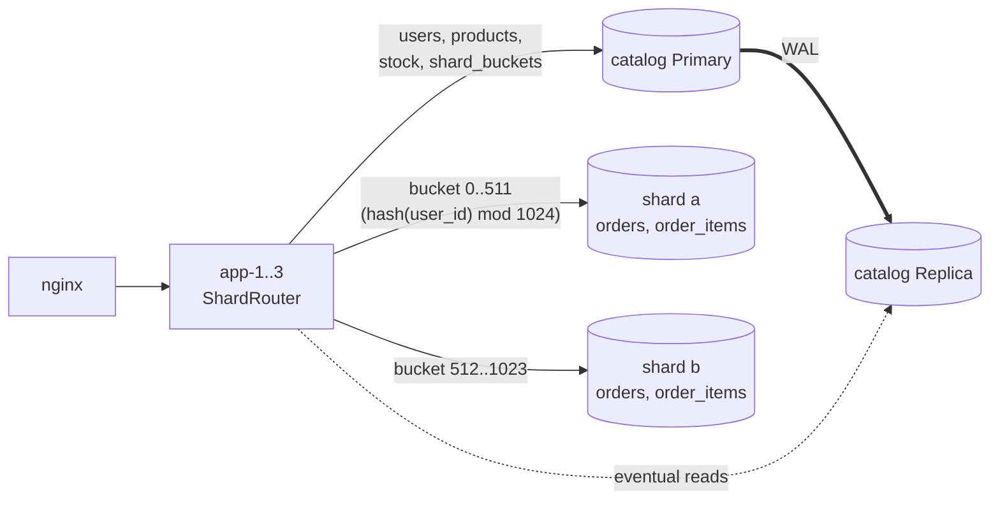

# ЛР № 7 — Data Scaling: Sharding та Partitioning

## 1. Вибір Dataset та Shard Key

**Що шардуємо:** агрегат **замовлення** (`orders` + `order_items`). Це найбільша сутність, яка постійно росте: у ЛР5 сценарій B за 2.5 хв записав ~340k замовлень. Вона ж дає весь write-трафік, і на ній сидить найдорожчий запит системи (`GET /orders/my`, ЛР5). Каталог (`products`, `users`, `categories`) маленький, read-heavy, і його вже масштабує кеш з реплікою, тож він лишається в окремій БД **catalog** (Primary + Replica з ЛР6).

**Shard Key = `user_id`:**

| Критерій | Оцінка |
|---|---|
| **Cardinality** | висока: 2 000 seed-користувачів і росте разом з бізнесом; бакетів (1024) значно менше за кількість ключів, тож розподіл рівний |
| **Query Locality** | усі запити користувача — історія (`/orders/my`), деталі (`/orders/{id}` перевіряє власника), checkout — **shard-local**, без fan-out |
| **Рівномірність запису** | кожен користувач пише лише свої замовлення; при хешуванні запис розподіляється рівно (див. матрицю) |
| **Ізоляція агрегату** | замовлення з позиціями ніколи не перетинає межу шарду, тож локальні ACID-транзакції на шарді зберігаються |

**Чому не сурогатний `order.id`:** автоінкрементний id рівномірно розподіляє *рядки*, але **жоден** запит не шукає замовлення за діапазоном id. Історія користувача (`WHERE user_id = ?`) розкидалась би по всіх шардах, і кожне читання ставало б fan-out на N вузлів. Ключ має відповідати шаблону доступу, а не лише рівномірності.

**Чому не `region`:** низька кардинальність (3 значення), а 80 % користувачів у Києві. Це гарантований Hot Shard (див. розділ 3).

Відома межа обраного ключа — **«гарячий тенант»**: один дуже активний користувач (B2B-клієнт із тисячами замовлень за хвилину) завжди потрапить на один шард, і хешування цього не виправить. Рішення: складений ключ (`user_id`, `month`) або виділений шард для таких тенантів.

## 2. Архітектура та Routing Logic



* **Application-Level Sharding** у Data Access Layer ([`shard/`](../src/main/java/ua/highload/shop/shard/)): [`ShardRegistry`](../src/main/java/ua/highload/shop/shard/ShardRegistry.java) тримає окремий пул HikariCP, `TransactionTemplate` і Flyway-схему ([`db/shard`](../src/main/resources/db/shard/)) для кожного шарду. [`ShardRouter`](../src/main/java/ua/highload/shop/shard/ShardRouter.java) обирає шард за `user_id`.
* **Стратегії** (`SHARD_STRATEGY`): `MODULO` (`user_id % N`), `HASH` (`fmix64(user_id) % N`), **`BUCKETS`** (за замовчуванням: `fmix64(user_id) mod 1024` → бакет → таблиця `shard_buckets` у каталозі), `REGION` (демонстрація поганого ключа).
* **Virtual Buckets:** відображення «бакет → шард» лежить у таблиці `shard_buckets` ([`V5__shard_buckets.sql`](../src/main/resources/db/migration/V5__shard_buckets.sql)), а кожен інстанс перечитує його кожні 5 с. Щоб перенести дані, достатньо змінити рядки цієї таблиці і запустити `POST /api/admin/shards/rebalance`; формула хешування не змінюється ніколи.
* **Глобально унікальні id** без координації: кожен шард має власну послідовність `START 1 000 000 + index, INCREMENT 16` (шард a: 1 000 000, 1 000 016, …; шард b: 1 000 001, 1 000 017, …).
* **Детермінованість:** `GET /api/admin/shards/route?userId=7` → `{"bucket":477,"shard":"a"}`. Той самий user завжди потрапляє на той самий шард на будь-якому інстансі.
* **Міграція даних:** `POST /api/admin/shards/migrate-legacy` переносить замовлення з монолітної таблиці каталогу (50k замовлень за 3.6 с), а `POST /api/admin/shards/rebalance` переносить рядки, що лежать «не на своєму» шарді. Перенесення ідемпотентне: спершу копія з `ON CONFLICT DO NOTHING`, потім видалення з джерела. Збій посередині дає дубль, а не втрату.

## 3. Розподіл даних і Hot Shard

### Dataset Distribution Baseline (BUCKETS, після міграції)

| Шард / Вузол | Кількість записів (orders) | Частка даних | Позицій (order_items) | Користувачів | Бакетів | Частка Write Operations* |
|---|---|---|---|---|---|---|
| Shard A (`postgres-shard-a`) | 24 541 | 49.1 % | 73 433 | 980 | 512 | 47 % |
| Shard B (`postgres-shard-b`) | 25 459 | 50.9 % | 76 163 | 1 020 | 512 | 53 % |

\* частка записів — приріст рядків на кожному шарді за 30 с сценарію B (100 VUs, 1000 користувачів): +24 840 / +27 794.

### Data Distribution Matrix — куди потрапили б 2 000 користувачів за кожною стратегією

| Стратегія | Shard A | Shard B | Дисбаланс |
|---|---|---|---|
| `MODULO` (`user_id % 2`) | 1 000 | 1 000 | 0 % |
| `HASH` (`fmix64 % 2`) | 970 | 1 030 | ±3 % |
| `BUCKETS` (1024 бакети 512/512) | 980 | 1 020 | ±2 % |
| `REGION` (Kyiv → A) | **1 600** | **400** | **80 / 20** |

Джерело: `GET /api/admin/shards/matrix` → [`results/lab07/matrix.json`](../results/lab07/matrix.json).

`MODULO` на послідовних id розподіляє ідеально (1000/1000), але лише тому, що id послідовні. Достатньо, щоб id генерувались, наприклад, з кроком 2 (кілька генераторів), і `user_id % 2` відправив би всіх на один шард. Хеш (`HASH`, `BUCKETS`) не залежить від структури ключа. `REGION` дає 80/20.

### Hot Shard Scenario

Стратегія `REGION` (ключ із 3 значеннями: Kyiv → a, інші → b) проти `BUCKETS`. Сценарій B (запис замовлень), 100 VUs, 30 с; частка записів рахується як приріст рядків на кожному шарді.

Запис (B, 100 VUs, 30 с):

| Стратегія | RPS | p50, мс | p95, мс | p99, мс | Записів A / B | Частка A / B | CPU shard A / B |
|---|---|---|---|---|---|---|---|
| **REGION** | 1 247 | 63.0 | 214.3 | 300.2 | 29 682 / 7 439 | **80 % / 20 %** | **0.58 / 0.21** |
| **BUCKETS** | **1 744** | **30.4** | **174.3** | **246.2** | 24 840 / 27 794 | 47 % / 53 % | 0.46 / 0.53 |

Shard-local читання (`GET /orders/my`, 50 VUs, 30 с), латентність окремо для користувачів кожного шарду (k6 тегує запит шардом користувача за `GET /api/admin/shards/route`):

| Стратегія | RPS | Користувачі шарду A: p50 / p95 / p99, мс | Користувачі шарду B: p50 / p95 / p99, мс | CPU shard A / B (ліміт 2.0) |
|---|---|---|---|---|
| **REGION** | 720 | **95.1 / 192.2 / 201.4** | 4.3 / 10.6 / 15.7 | **1.88** / 0.16 |
| **BUCKETS** | **1 170** (+62 %) | 7.0 / 20.8 / 65.9 | 81.3 / 183.5 / 201.1 | 1.40 / 1.94 |

* **REGION — класичний Hot Shard:** шард A отримує 80 % записів і 80 % читань і насичений (1.88 з 2 ядер), а шард B майже простоює (0.16). Користувачі з Києва бачать p50 = 95 мс, решта — 4 мс, тобто **в 22 рази різний досвід** залежно від регіону. Пропускну здатність усього кластера визначає один перевантажений вузол.
* **BUCKETS вирівнює навантаження:** записи 47/53 %, CPU обох шардів працює. Throughput читання **+62 %** (720 → 1 170 RPS), запису **+40 %** (1 247 → 1 744 RPS), p50 запису вдвічі нижчий.
* Залишкова асиметрія в BUCKETS (шард B завантажений сильніше: 1.94 проти 1.40) — **не дані**: обсяги майже рівні (24.5k / 25.5k рядків, однакові розміри таблиць), ізольований однаковий запит виконується однаково (9–14 мс на обох). Це особливість стенду: rootless podman не делегує `cpuset`, і на гібридному CPU (P- і E-ядра) контейнери отримують ядра різної продуктивності. Віртуальні бакети якраз дозволяють компенсувати це, віддавши «слабшому» вузлу менше бакетів.
* Перехід між стратегіями виконано наживо: перезапуск із `SHARD_STRATEGY=…` + `POST /api/admin/shards/rebalance` (REGION: 19 979 замовлень B→A і 4 661 A→B).

## 4. Cross-Shard операції

### 4.1 Cross-Shard Query (Scatter-Gather)

* `GET /api/stats/top-products/live`: кожен шард паралельно (віртуальні потоки) рахує `sum(quantity), sum(revenue) GROUP BY product_id` для своїх даних (**scatter**); застосунок зливає часткові суми по `product_id`, сортує і бере top-N (**gather**), а назви товарів читає з каталогу (Replica).
* `GET /api/stats/sales?days=30`: `count/sum/count(distinct user_id)` на кожному шарді, сума в застосунку. Унікальних покупців можна просто додати, бо ключ шардування — `user_id`, і множини покупців на шардах не перетинаються. Для довільного ключа `count(distinct)` між шардами вимагав би злиття множин або HyperLogLog.

Shard-Local vs Cross-Shard, 20 VUs, 30 с:

| Запит | Тип | RPS | p50, мс | p95, мс | p99, мс | CPU shard A / B |
|---|---|---|---|---|---|---|
| `GET /orders/my` | **shard-local** (1 шард) | **1 282** | **6.2** | 69.0 | 78.9 | 1.61 / 1.91 |
| `GET /stats/sales?days=30` | fan-out: count/sum | 312 | 76.0 | 102.5 | 171.0 | 1.12 / 2.01 |
| `GET /stats/top-products/live` | fan-out: GROUP BY + merge у застосунку | 63 | 301.4 | 491.1 | 594.0 | 1.13 / 2.01 |

* **Shard-local** запит торкається одного вузла: p50 = 6 мс, 1 282 RPS.
* **Fan-out** торкається **всіх** вузлів: кожен запит споживає ресурси N шардів, а латентність = латентність **найповільнішого** шарду плюс злиття (tail at scale). `top-products/live` у 20 разів дорожчий за shard-local, бо сканує й агрегує всю `order_items` на обох шардах. Тому такі запити або **кешуються** (`/stats/top-products` з TTL 30 с, ЛР4 і ЛР8), або виносяться в окреме аналітичне сховище (OLAP, CDC → ClickHouse).
* Зі збільшенням кількості шардів shard-local запити масштабуються лінійно, а fan-out — ні: N шардів означає N підзапитів на кожен виклик, і ймовірність натрапити на повільний шард росте з N.

### 4.2 Cross-Shard Write: checkout = Saga

Checkout зачіпає **дві різні БД**: склад (`products.stock`) у каталозі та замовлення на шарді користувача. Локальна ACID-транзакція не може охопити два вузли.

```mermaid
sequenceDiagram
    participant A as app
    participant C as catalog (Primary)
    participant S as shard (user)
    A->>C: T1: BEGIN; SELECT … FOR UPDATE; UPDATE stock -= qty; COMMIT
    alt T1 ok
        A->>S: T2: BEGIN; INSERT orders, order_items; COMMIT
        alt T2 failed
            A->>C: C1 (компенсація): UPDATE stock += qty
            A-->>A: помилка клієнту, склад повернуто
        end
    else недостатньо товару
        A-->>A: 409, нічого не змінено
    end
```

Реалізація: [`OrderService.checkout`](../src/main/java/ua/highload/shop/service/OrderService.java). Чому Saga, а не 2PC:

| | 2PC (`PREPARE TRANSACTION`) | Saga (обрано) |
|---|---|---|
| Консистентність | атомарна | eventual: між T1 і T2 склад уже списано, а замовлення ще немає |
| Блокування | рядки складу заблоковані до фази COMMIT на обох вузлах (+ мережевий RTT координатора) | блокування лише всередині T1 (кілька мс) |
| Відмова координатора | **prepared-транзакції «зависають»** і тримають блокування до ручного втручання | компенсація; у гіршому разі «втрачений» резерв складу |
| Доступність | будь-який недоступний учасник блокує всіх | шард замовлень і каталог незалежні |

Ризик Saga: якщо застосунок упаде **між** T1 і T2 (або між невдалою T2 і C1), резерв складу «зависне». Продакшн-рішення: таблиця saga-log або **transactional outbox** у каталозі (записується в T1), плюс фоновий reconciler, який компенсує незавершені саги.

**Шард-локальний перепроєктований агрегат.** Альтернатива для переказів між рахунками на різних шардах — не змінювати два шарди атомарно, а записати подію «переказ» на шард відправника і асинхронно застосувати її на шарді отримувача (event-driven, ідемпотентно за id події).

### 4.3 Що ще ламає шардинг

* **Зовнішні ключі між БД неможливі:** до ЛР7 `DELETE /api/products/{id}` для купленого товару повертав `409` (FK `order_items → products`), тепер `204`. Цілісність забезпечує застосунок: soft delete або перевірка через fan-out. Top-products показує `(deleted)` для таких товарів.
* **Унікальні обмеження** працюють лише в межах шарду. Глобальна унікальність потребує або ключа, що містить shard key, або окремого реєстру (каталог).
* **Distributed JOIN** (`orders ⋈ products`) не виконується в БД, а збирається в застосунку (gather + lookup у каталозі).

## 5. Resharding: від `key % N` до Consistent Hashing / Virtual Buckets

**Модель** ([`scripts/lab7-resharding-model.py`](../scripts/lab7-resharding-model.py), 100k ключів, той самий хеш `fmix64`). Частка ключів, що змінюють шард при додаванні вузла:

| Стратегія | 2 → 3: переміщено | 3 → 4: переміщено | Ідеал (1/N_new) | Дисбаланс max/avg (N=3) | (N=4) |
|---|---|---|---|---|---|
| `key % N` | **66.7 %** | **75.0 %** | 33.3 % / 25.0 % | 1.00 | 1.00 |
| `hash(key) % N` | 66.3 % | 74.7 % | 33.3 % / 25.0 % | 1.01 | 1.00 |
| consistent hashing, 1 vnode на вузол | 7.2 % | 13.9 % | | **2.68** | **3.02** |
| consistent hashing, 128 vnodes | 32.3 % | 24.8 % | | 1.08 | 1.11 |
| **virtual buckets (1024)** | **33.2 %** | **24.9 %** | | **1.01** | **1.01** |

* **Наївний `key % N`:** ключ лишається на місці, лише якщо `k mod N = k mod (N+1)`, а це частка 1/(N+1). Решта, **N/(N+1)**, переїжджає: 67 % при 2→3, 75 % при 3→4. При 10→11 це вже 91 %, тобто майже повна міграція. Хеш перед модулем цього не змінює.
* **Consistent hashing:** ключі й вузли лежать на одному кільці, ключ належить першому вузлу за годинниковою стрілкою. Новий вузол забирає ключі лише в сусідів, тож переміщується ≈ **1/N** даних. З одним токеном на вузол дуги кільця нерівні (дисбаланс до 3×). **Віртуальні вузли** (128 токенів на сервер) вирівнюють навантаження до ±10 %.
* **Virtual buckets** (наш вибір; так зроблено в Couchbase, Redis Cluster з 16 384 слотами, Elasticsearch): кількість бакетів фіксована (1024 ≫ N). Додати вузол — це перенести **рівно 1/N бакетів** (≈ 1/N даних, 33.2 % і 24.9 %) з ідеальним балансом. Відображення бакетів явне, керується таблицею, його можна змінювати поступово (бакет за бакетом), і ним легко зсунути «гарячий» бакет на менш завантажений шард.

**Практична демонстрація** на нашому кластері: перехід «1 вузол → 2 шарди» виконано зміною `shard_buckets` (`UPDATE … SET shard = CASE WHEN bucket < 512 THEN 'a' ELSE 'b' END`) і `POST /api/admin/shards/rebalance`, без зміни коду і без зупинки застосунку (див. розділ 6).

## 6. Performance Benchmark: Single Node vs Sharded

Single Node = усі 1024 бакети → шард a (уся таблиця замовлень на одному вузлі з 2 CPU); Sharded = 512/512 на два вузли по 2 CPU. Дані скинуто до seed-стану, каталог (Primary + Replica, кеш) однаковий.

Перед **кожним** виміром дані скидаються до seed-стану (50k замовлень). Перший варіант серії без скидань показав, що записи сценарію B роздувають таблиці, і подальші вимірювання читання порівнюють різні обсяги даних (сирі дані того варіанта: [`results/lab07/first-run/`](../results/lab07/first-run/)).

| Навантаження | Single: RPS | Single: p95 / p99, мс | Sharded: RPS | Sharded: p95 / p99, мс | Speedup | Err single / sharded | CPU шардів: single → sharded | CPU catalog primary |
|---|---|---|---|---|---|---|---|---|
| B · 50 VUs | 1 785 | 54.9 / 81.5 | 1 551 | 56.5 / 87.5 | 0.87× | 0 / 0 % | 0.82 → 0.46 + 0.45 | 0.91 / 0.77 |
| B · 100 VUs | 1 219 | 145.2 / 185.8 | 1 352 | 146.1 / 187.9 | 1.11× | 0 / 0 % | 0.66 → 0.43 + 0.49 | 0.69 / 0.84 |
| B · 200 VUs | 1 538 | 380.4 / 456.6 | 1 383 | 384.2 / 441.8 | 0.90× | 0 / 0 % | 0.70 → 0.42 + 0.48 | 0.75 / 0.83 |
| **C · 50 VUs** | 1 471 | 152.1 / 203.3 | **3 255** | **60.0 / 103.6** | **2.21×** | 0 / 0 % | 1.63 → 1.04 + 1.09 | 0.18 / 0.32 |
| **C · 100 VUs** | 1 500 | 289.2 / 490.3 | **2 827** | **159.8 / 272.7** | **1.89×** | 0 / 0 % | 1.78 → 0.95 + 1.11 | 0.15 / 0.35 |
| **C · 200 VUs** | 1 399 | 697.7 / 1 516.2 | **2 865** | **318.3 / 546.6** | **2.05×** | 0.06 / 0 % | 1.80 → 1.01 + 1.09 | 0.17 / 0.30 |
| shard-local `/orders/my` · 20 VUs | 497 | 98.1 / 101.8 | **1 317** | 70.1 / 79.2 | **2.65×** | 0 / 0 % | 1.94 → 1.59 + 1.88 | — |
| fan-out `/top-products/live` · 20 VUs | 39 | 701.2 / 803.7 | 66 | 405.5 / 500.5 | 1.69× | 0 / 0 % | 1.96 → 1.10 + 1.95 | — |

* **Сценарій C і shard-local читання масштабуються у 2–2.65 раза:** вузьке місце (seq scan історії замовлень, ЛР5) розподілилось на два вузли по 2 CPU, і кожен вузол сканує вдвічі менше даних. p99 сценарію C при 200 VUs упав з 1.5 с до 0.55 с. Надлінійність shard-local (2.65× при 2 вузлах) пояснюється тим, що запит без індексу коштує O(розмір шарду), тож удвічі менший шард дає удвічі дешевший запит і вдвічі більше CPU.
* **Fan-out теж прискорився (1.69×)**, бо шарди сканують свої половини паралельно, але він обмежений найповільнішим шардом (B: 1.95 ядра).
* **Сценарій B (запис) від шардингу не виграв** (0.87–1.11×, у межах шуму): шарди завантажені лише на 0.4–0.5 ядра. Кожен checkout списує склад у **каталозі**, тож кожне замовлення проходить через один Primary з блокуванням рядків товарів, а інстанси застосунку завантажені на ~0.8–1.0 CPU. Шардинг масштабує лише ту частину запису, яку шардовано. Щоб масштабувати checkout далі, треба шардувати й залишки складу (наприклад, за `product_id` або через резервування на рівні складів) або винести списання в асинхронну обробку.
* **Ціна шардингу:** Saga замість ACID, відсутність FK, fan-out для аналітики, операційна складність (5 вузлів БД замість 2, міграції на кожному шарді, rebalance).

## 7. Питання до захисту

* **Партиціювання vs шардинг vs реплікація.** *Партиціювання* — розбиття таблиці на частини **всередині одного вузла СУБД** (`PARTITION BY RANGE/HASH/LIST` у PostgreSQL): дає partition pruning і дешеве видалення старих даних (`DROP PARTITION`), але не додає CPU чи дисків. *Шардинг* — горизонтальне розбиття даних **між різними вузлами**: масштабує і запис, і обсяг, ціною cross-shard запитів і втрати глобальних транзакцій і FK. *Реплікація* — **копії тих самих даних** на кількох вузлах: масштабує читання і дає відмовостійкість, але не запис і не обсяг. На практиці їх комбінують: кожен шард — це Primary + Replica.
* **Distributed JOIN, unique constraints, 2PC, Saga** — див. розділ 4.
* **Consistent Hashing** — див. розділ 5.
