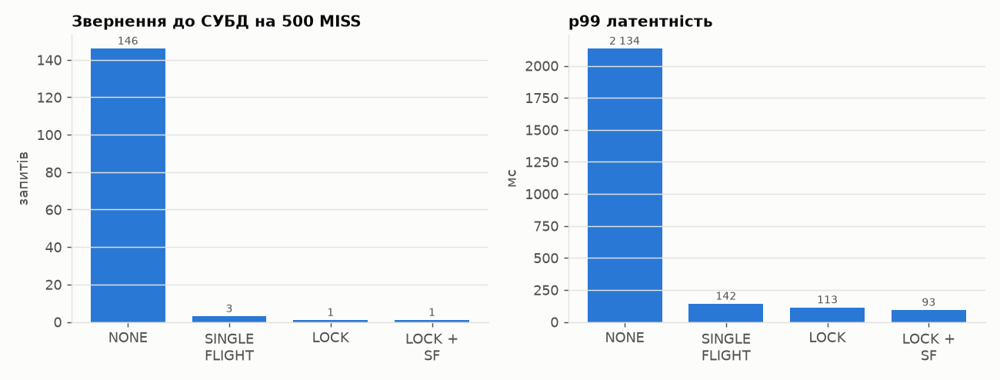
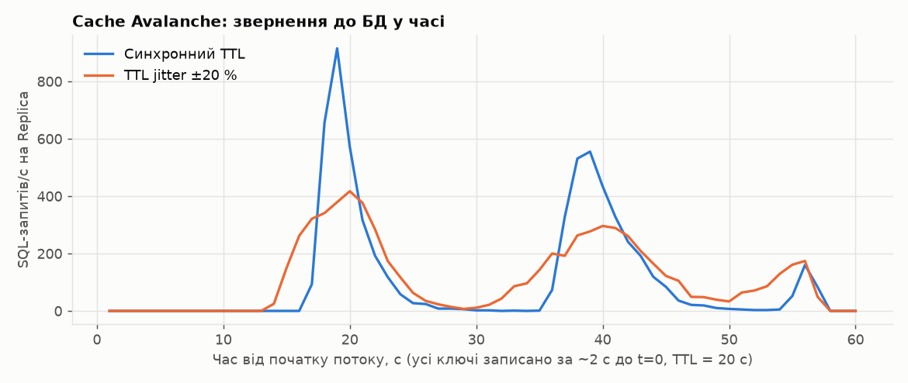
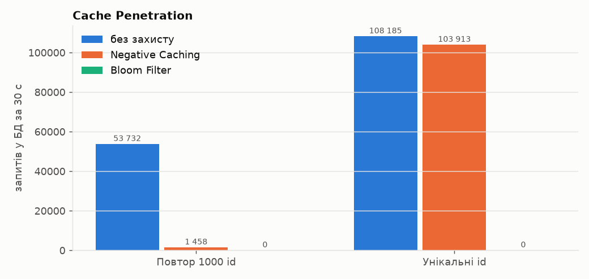

# ЛР № 8 — Resilience Engineering: Cache Stampede, Thundering Herd, Avalanche, Penetration

## 1. Ресурсоємний кешований об'єкт

**`GET /api/stats/top-products`** — глобальний лідерборд товарів за продажами (ЛР4, ЛР7):

* після шардингу це **cross-shard scatter-gather**: кожен шард агрегує всю `order_items` (`GROUP BY product_id`, ~75k рядків на шард), застосунок зливає часткові суми і дочитує назви з каталогу. Обчислення без кешу: ~300 мс p50 при 20 VUs (`/top-products/live`, ЛР7);
* найпопулярніший віджет головної сторінки (усі користувачі отримують той самий ключ `shop:stats:top-products:v1:limit10`), TTL 30 с.

**Критичність MISS:** коли ключ вигасає, кожен запит у вікні перерахунку (~0.3–2 с під навантаженням) сам запускає fan-out на **всі** шарди. Сотні таких запитів вичерпують пули з'єднань шардів (10 на інстанс) і завантажують CPU усіх вузлів БД, а через спільні шарди гальмують і checkout, і історію замовлень. Це Thundering Herd на рівні всього кластера.

## 2. Реалізовані механізми

| Механізм | Де | Суть |
|---|---|---|
| **Single-Flight / Request Coalescing** | [`StampedeGuard`](../src/main/java/ua/highload/shop/cache/StampedeGuard.java) | `ConcurrentHashMap<key, CompletableFuture>`: перший MISS на інстансі стає лідером і рахує, решта паралельних MISS того самого ключа чекають на його Future. Не більше одного перерахунку на інстанс |
| **Distributed Mutex (Redis `SET NX PX`)** | `StampedeGuard.withLock` | `SET lock:<key> <uuid> NX PX 5000`: перераховує лише власник; він ще раз перевіряє кеш (ключ міг заповнити попередній власник), рахує, пише в кеш і знімає lock **Lua compare-and-delete** (`if GET == token then DEL`). Решта опитують кеш з експоненційним backoff 10 → 100 мс до 3 с |
| **LOCK + SINGLE_FLIGHT** (за замовчуванням) | | single-flight всередині інстансу, distributed lock між інстансами: у Redis за lock конкурують лише лідери (≤ кількості інстансів), а не сотні запитів |
| **TTL Jitter** | `CacheClient.jittered` | `TTL = base × (1 ± 20 %)` для всіх ключів кешу |
| **Negative Caching** | `CacheClient.getOrLoad` | `loader` повернув «немає»: у кеш пишеться маркер `__null__` з TTL 30 с, і наступні запити того самого id отримують 404 з Redis |
| **Bloom Filter** | [`ProductBloomFilter`](../src/main/java/ua/highload/shop/cache/ProductBloomFilter.java) | бітмапа Redis (m = 2²⁰ біт = 128 KB, k = 5, double hashing на `fmix64`), перевірка однією Lua-командою. «Ні» означає 404 без Redis-кешу і без БД. Спільна для всіх інстансів; самовідновлюється (див. Failure Modes) |

Режими перемикаються **наживо** через Redis hash `shop:flags` ([`FeatureFlags`](../src/main/java/ua/highload/shop/cache/FeatureFlags.java), інстанси перечитують його щосекунди): `PUT /api/admin/flags {"stampede":"NONE"}`. Порівняння проводиться на тих самих прогрітих JVM, без рестарту. Заголовок `X-Cache` отримав статус **`COALESCED`**: значення обчислив інший запит, цей лише дочекався.

## 3. Cache Stampede & Thundering Herd: відтворення і захист

Методика ([`scripts/lab8-experiments.sh`](../scripts/lab8-experiments.sh), [`load-tests/lab8/stampede.js`](../load-tests/lab8/stampede.js)):

1. `DEL shop:stats:top-products:v1:limit10` (Force Expire);
2. **500 VUs одночасно** роблять по одному запиту (`per-vu-iterations`);
3. звернення до СУБД рахуються двома незалежними способами: дельта `pg_stat_statements.calls` агрегаційного запиту на шардах (÷2, бо кожен перерахунок — це 2 scatter-запити) і лічильник фактичних виконань loader'а `shop.cache.loads` на всіх інстансах (`/actuator/metrics`). Обидва збіглися в кожному прогоні;
4. по 3 прогони на режим.

| Режим | Перерахунків у БД (scatter-запитів на шард) | Throughput (RPS) | p50, мс | p95, мс | p99, мс | max, мс | Error Rate | MISS / COALESCED / HIT |
|---|---|---|---|---|---|---|---|---|
| NONE | 146 / 164 / 126 | 228 | 335 | 2062 | 2134 | 2161 | 14.20 / 13.80 / 0.00 % | 138/0/291 ; 143/0/288 ; 126/0/374 |
| SINGLE_FLIGHT | 3 / 3 / 3 | 3034 | 54 | 93 | 142 | 145 | 0.00 / 0.00 / 0.00 % | 3/370/127 ; 3/232/265 ; 3/456/41 |
| LOCK | 1 / 1 / 1 | 3628 | 84 | 108 | 113 | 114 | 0.00 / 0.00 / 0.00 % | 1/499/0 ; 1/410/89 ; 1/499/0 |
| LOCK_SINGLE_FLIGHT | 1 / 1 / 1 | 3899 | 61 | 88 | 93 | 95 | 0.00 / 0.00 / 0.00 % | 1/499/0 ; 1/499/0 ; 1/499/0 |



* **Без захисту** 126–164 запити з 500 самостійно пішли в БД: це всі, хто отримав MISS до того, як найшвидший перерахунок записав значення. Ці 2×(126–164) scatter-запитів одночасно вичерпали пули з'єднань шардів, і **до 14 % запитів упали** з `503 Database is overloaded`, а p99 = 2.1 с (у першому прогоні — 5.5 с).
* **Single-flight:** рівно **3 перерахунки**, по одному на інстанс (координація лише локальна), p99 ~ 140 мс, 0 помилок.
* **Distributed lock** і **lock + single-flight:** рівно **1 перерахунок** на весь кластер (`MISS = 1`, `COALESCED = 499`), p99 ~ 93–113 мс. Звернення до СУБД зменшились зі ~145 до 1.

## 4. Cache Avalanche: синхронне вигасання і TTL Jitter

3 000 карток товарів записуються в кеш одночасно (~2 с, `MODE=warm`) з TTL 20 с (`productTtlSeconds=20` через прапорці), далі 60 с постійний потік 1 500 запитів/с (open model) по цих же ключах. Щосекунди знімаються запити до Replica (`pg_stat_statements`).

| Режим | Пік SQL/с | Секунд з > 300 SQL/с | Сумарно запитів у БД за 60 с | p95, мс | p99, мс | max, мс |
|---|---|---|---|---|---|---|
| Без jitter (синхронний TTL) | 915 | 9 | 6288 | 1.6 | 2.6 | 38.0 |
| TTL jitter ±20 % | 417 | 5 | 6671 | 1.7 | 2.3 | 24.3 |



* **Синхронний TTL:** до t ≈ 17 с у БД 0 запитів, потім **усі 3 000 ключів вигасають за ~3 с**, і на БД приходить пік **915 SQL/с**. Ключі, перезавантажені в цьому піку, знову отримують однаковий TTL, тож лавина **повторюється** через 20 с (556 SQL/с на t ≈ 39 с), а потім ще раз.
* **TTL jitter ±20 %:** вигасання розмазане по 16–24 с, пік **417 SQL/с (−54 %)**, і з кожною хвилею піки згладжуються далі (296, потім 175). Сумарна кількість запитів та сама (~6.5k): jitter не зменшує кількість перерахунків, а **розподіляє їх у часі**.
* На латентність клієнта лавина тут майже не вплинула (p99 2.6 мс), бо PK-запит на репліці дешевий, а пул з'єднань не вичерпується. Для дорогих ключів (як top-products) той самий синхронний пік дав би картину розділу 3. Тому jitter увімкнено для **всіх** ключів кешу.

## 5. Cache Penetration: Negative Caching vs Bloom Filter

`GET /api/products/{id}` з неіснуючими id, 50 VUs, 30 с; запити до БД — дельта `pg_stat_statements` на Replica. Два патерни атаки: (а) 1 000 однакових неіснуючих id по колу (бот перебирає список); (б) щоразу новий випадковий id з діапазону 10⁷–10⁹.

| Патерн | Захист | Запитів у БД | Throughput (RPS) | p95, мс | p99, мс |
|---|---|---|---|---|---|
| 1000 однакових неіснуючих id | без захисту | 53 732 | 1643 | 72.1 | 142.2 |
| 1000 однакових неіснуючих id | Negative Caching | 1 458 | 4539 | 71.2 | 84.2 |
| 1000 однакових неіснуючих id | Bloom Filter | 0 | 5683 | 60.9 | 74.7 |
| щоразу новий випадковий id | без захисту | 108 185 | 3605 | 73.4 | 85.8 |
| щоразу новий випадковий id | Negative Caching | 103 913 | 3458 | 72.9 | 82.6 |
| щоразу новий випадковий id | Bloom Filter | 0 | 6436 | 59.1 | 80.3 |
saved docs/img/lab08-penetration.png



* **Negative caching** знижує навантаження на 97 % для повторюваних id (1 458 запитів: 1 000 перших MISS + повтори після вигасання маркера через 30 с). Проти унікальних id він **марний**: 104k запитів у БД, бо кожен id новий, ще й Redis засмічується ~100k маркерів (~8 MB за кожні 30 с атаки).
* **Bloom filter** відсікає **100 %** неіснуючих id обох патернів ще до кешу і БД (0 запитів) і дає найвищий throughput (5.7–6.4k RPS), бо одна Lua-команда з 5 `GETBIT` дешевша за `GET` у кеш і серіалізацію відповіді.
* Ймовірність хибнопозитивної відповіді для 10k товарів: (1 − e^(−kn/m))^k = (1 − e^(−5·10⁴/2²⁰))⁵ ≈ 2·10⁻⁷. Такий запит просто піде звичайним шляхом (кеш → БД → 404 → negative-маркер), тож обидва механізми доповнюють один одного.

## 6. Failure Modes Analysis

| Ризик | Де | Як оброблено |
|---|---|---|
| **Deadlock / вічний lock:** власник упав, не знявши lock | distributed lock | lock **завжди** має TTL (`PX 5000`) і вигасає сам; очікувачі мають власний таймаут 3 с, після якого перераховують самі (лічильник `shop.cache.lock.timeouts`). Це деградація до режиму NONE, а не помилка |
| **Lock Expiration Timeout:** перерахунок довший за TTL lock'а, lock вигас, і його взяв другий власник | | можливий подвійний перерахунок (2 замість 1, а не 500). Зняття через compare-and-delete не дає першому власнику видалити **чужий** lock. Для операцій, де подвійне виконання неприпустиме, потрібен **fencing token** (монотонний номер з `INCR`, який перевіряє ресурс). Для ідемпотентного перерахунку кешу достатньо TTL > p99 обчислення |
| **Redis недоступний** | lock, флаги, Bloom | lock не взяли, тож рахуємо без координації; флаги лишаються з останніми відомими значеннями; Bloom «fail-open» (пропускає все), тобто фільтр — оптимізація, а не джерело істини |
| **Single-flight: «отруєний» Future** | | виняток лідера (наприклад, 404) отримують і всі очікувачі, це коректно. Future видаляється з мапи у `finally`, тож наступний запит почне новий перерахунок. Повільний лідер тримає всіх очікувачів, але на рівні одного інстансу, і час обмежений таймаутами БД |
| **Пам'ять під Negative Cache** | | маркер короткий (`__null__`, TTL 30 с), але атака унікальними id створює ~100k ключів на 30 с. Від такої атаки захищає Bloom, а не negative cache |
| **Застарілі негативні відповіді:** товар створили після того, як його id закешували як «немає» | | `POST /api/products` додає id в Bloom **і** видаляє negative-маркер |
| **Втрата Bloom-бітмапи** (FLUSHALL, рестарт Redis без AOF) | | Lua-скрипт повертає −1 («не побудовано»), і запит іде звичайним шляхом. Фоново запускається перебудова з БД (lock `lock:bloom-build`, будує один інстанс). Ми знайшли цей сценарій під час власного експерименту: скрипт скидання даних видаляв `shop:*`, і перший прогін Penetration з «Bloom» показав 67k запитів у БД. Після виправлення: перебудова < 2 с (`results/lab08/pen-invalid/` — невалідний прогін) |
| **Видалені товари в Bloom** | | класичний Bloom не підтримує видалення; видалений id лишається «можливо є» і доходить до negative cache. Періодична перебудова (`POST /api/admin/bloom/rebuild`) або Counting Bloom / Cuckoo filter |
| **SWR не реалізовано свідомо** | | Stale-While-Revalidate потребує зберігати «логічний» TTL всередині значення і фоновий пул оновлень. Для лідерборду з TTL 30 с lock + single-flight дає той самий ефект (1 перерахунок) без віддачі застарілих даних |

## 7. Resilience Profile

```
=== RESILIENCE PROFILE (ЛР8) ===
Hot key (top-products, fan-out по 2 шардах):
  Stampede 500 req, cold key:  NONE → 126–164 перерахунки, p99 2.1–5.5 s, до 14 % помилок
                               LOCK+SINGLE_FLIGHT → 1 перерахунок, p99 93 ms, 0 % помилок
Avalanche (3000 ключів, TTL 20 s):  пік 915 → 417 SQL/s з TTL jitter ±20 %, повторні хвилі згасають
Penetration (неіснуючі id):    Negative cache −97 % (повтори) / 0 % (унікальні); Bloom −100 % в обох
Coordination timeouts:        lock TTL 5 s, wait 3 s → fallback без координації (без deadlock'ів)
Cache unavailable:            BYPASS + circuit breaker 5 s (ЛР4); lock/Bloom — fail-open
Runtime switches:             Redis hash shop:flags (stampede | ttlJitter | negative | bloom | productTtlSeconds)
```

## 8. Питання до захисту

* **Stampede vs Thundering Herd vs Avalanche vs Penetration.** *Cache Stampede* — багато запитів одночасно отримують MISS **одного** ключа й одночасно його перераховують. *Thundering Herd* — наслідок для бекенду: «стадо» одночасних звернень до СУБД, що вичерпує її ресурси (у нас це 14 % помилок через вичерпаний пул). *Cache Avalanche* — одночасне вигасання **багатьох** ключів (однаковий TTL) або падіння всього кешу, тобто масова хвиля MISS. *Cache Penetration* — запити до **неіснуючих** даних, які кеш взагалі не може закешувати, тож вони завжди доходять до БД (часто це атака).
* **Redlock** — алгоритм distributed lock на N незалежних Redis-вузлах: lock вважається взятим, якщо вдалося взяти його на більшості (N/2+1) за час, менший за TTL. **Критика (Martin Kleppmann):** алгоритм покладається на обмежені затримки й синхронізований час; GC-пауза або стрибок годинника можуть дати двом клієнтам одночасне «володіння». Для коректності (а не лише ефективності) потрібні **fencing tokens**, які перевіряє сам ресурс. Наш випадок — **ефективність** (не рахувати двічі), і там достатньо одного Redis з TTL.
* **Bloom Filter** — ймовірнісна множина з bitmap та k хеш-функцій. Хибні «так» можливі з імовірністю (1 − e^(−kn/m))^k, хибних «ні» не буває. Оптимальне k = (m/n)·ln 2.
* **Probabilistic Early Expiration (XFetch):** запит сам вирішує перерахувати значення **до** вигасання з імовірністю, що зростає біля TTL: `now − Δ·β·ln(rand) ≥ expiry`, де Δ — час обчислення. Дорогі ключі (великий Δ) оновлюються раніше. Без lock'ів дає в середньому один ранній перерахунок і повністю прибирає MISS для гарячих ключів. Плата — потрібно зберігати Δ і expiry поруч зі значенням.
