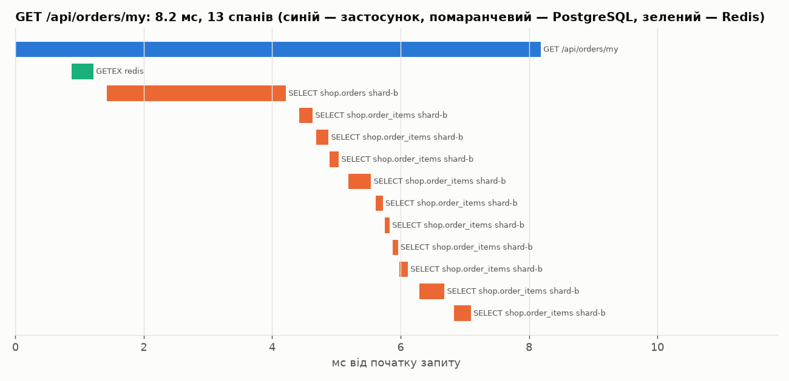
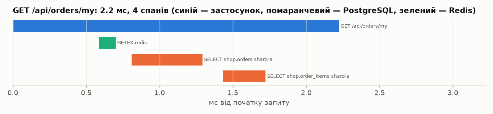

# ЛР № 9 — Performance Profiling та Bottleneck Diagnostics

Цикл: **Symptom → Hypotheses → Instrumentation → Evidence → Root Cause → Optimization → Regression Verification.**

## 1. Симптом і гіпотези

**Симптом** (ЛР5, ЛР7): у сценарії C (Complex Workflow) PostgreSQL насичений по CPU (1.95 з 2 ядер на одному вузлі; після шардингу ~1.0 на кожному шарді), а застосунки недовантажені. p95/p99 сценарію C у 3–10 разів вищі за сценарій A. Найдорожчий ендпоінт — `GET /api/orders/my` (історія замовлень). У ЛР5 на нього припадало 95.8 % часу БД.

| # | Гіпотеза | Як перевірити |
|---|---|---|
| **H1** | Запит історії робить **Full Table Scan** `orders`, бо немає індексу по `user_id`, і вартість росте лінійно з обсягом таблиці | `pg_stat_statements` (частка часу, mean), `EXPLAIN (ANALYZE, BUFFERS)` |
| **H2** | **N+1**: позиції кожного замовлення читаються окремим запитом (1 + 10 round-trip'ів на виклик), що тримає з'єднання з пулу й додає мережеві затримки | співвідношення `calls` у `pg_stat_statements`, distributed tracing |
| **H3** | **Connection Pool Exhaustion**: пулу шардів (10 з'єднань на інстанс) не вистачає, і запити стоять у черзі Hikari | метрики `hikaricp.connections.pending/active`, wall-clock профіль (`ConcurrentBag.borrow`) |
| H4 | GC-паузи / витік пам'яті в застосунку | JFR: GC pauses, heap after GC, allocation rate |

## 2. Інструментування

| Інструмент | Що знімалось | Артефакт |
|---|---|---|
| **pg_stat_statements** (на кожному шарді, скидання перед прогоном) | частка часу, `calls`, `mean_exec_time` | `profiling/<phase>-pg_stat_statements.txt` |
| **EXPLAIN (ANALYZE, BUFFERS)** | план запиту історії та запиту позицій | `profiling/<phase>-explain.txt` |
| **async-profiler 4.6** (attach до PID 1 у контейнері) | CPU (`itimer`) + allocation профіль на app-1, wall-clock (усі потоки) на app-2, під навантаженням C, 100 VUs | flame graphs `profiling/<phase>-{cpu,alloc,wall}.html`, текстовий аналіз `profiling/<phase>-hotspots.txt` ([`scripts/flame_top.py`](../scripts/flame_top.py)) |
| **OpenTelemetry Java agent 2.33 → Jaeger** (`podman-compose --profile tracing`, `OTEL_AGENT=-javaagent:…`) | декомпозиція одного запиту на спани HTTP / JDBC / Redis | `profiling/traces/*.{txt,png,json}` ([`scripts/trace_waterfall.py`](../scripts/trace_waterfall.py)) |
| **Micrometer + HikariCP** (додано метрики для всіх пулів, включно з шардами) | `hikaricp.connections.active/pending` щосекунди | `results/lab09/<phase>-hikari.csv` |
| **JFR** (`-XX:StartFlightRecording`, settings=profile) | GC, heap після GC, allocation samples | `profiling/batch-jfr-summary.txt` |

Скрипти: [`scripts/lab9-profile.sh`](../scripts/lab9-profile.sh) (фаза: навантаження + профілі + БД-діагностика), [`scripts/lab9-asprof.sh`](../scripts/lab9-asprof.sh) (JFR-формат async-profiler → html/collapsed), [`scripts/lab9-ab-index.sh`](../scripts/lab9-ab-index.sh), [`scripts/lab9-ab-batch.sh`](../scripts/lab9-ab-batch.sh). Сирі `*.jfr` і `*.collapsed` (до 15 MB) у git не додаються, вони відтворюються цими скриптами.

## 3. Докази (Evidence)

### H1 — Full Table Scan: **ПІДТВЕРДЖЕНО (Root Cause)**

`pg_stat_statements`, шард A, C · 100 VUs, 60 с ([`profiling/baseline-pg_stat_statements.txt`](../profiling/baseline-pg_stat_statements.txt)):

```
 calls  | total_ms | mean_ms |  rows  | pct  | query
  17325 |    48148 |   2.779 | 173250 | 91.9 | SELECT … FROM orders WHERE user_id = $1 ORDER BY created_at DESC LIMIT …
 173250 |     1917 |   0.011 | 177457 |  3.7 | SELECT … FROM order_items WHERE order_id = $1 ORDER BY product_id
  17325 |     1386 |   0.080 |  17325 |  2.6 | INSERT INTO order_items …
```

`EXPLAIN (ANALYZE, BUFFERS)` ([`profiling/baseline-explain.txt`](../profiling/baseline-explain.txt)):

```
Limit (actual time=1.618..1.620 rows=10)
  Buffers: shared hit=281
  ->  Sort  Sort Key: created_at DESC  Sort Method: top-N heapsort
        ->  Seq Scan on orders (actual time=0.066..1.567 rows=152)
              Filter: (user_id = 42)
              Rows Removed by Filter: 31034          ← прочитано 31k рядків, щоб знайти 152
Execution Time: 1.646 ms
```

Один запит займає **92 % часу шарду**. Кожен виклик читає всю таблицю (281 сторінку буфера) і відкидає 99.5 % рядків, а потім сортує. Вартість O(розмір шарду): у ЛР5 (одна БД, 440k замовлень) той самий запит коштував 283 мс.

### H2 — N+1: **ПІДТВЕРДЖЕНО (вторинна причина)**

* `calls`: 17 325 запитів історії → **173 250** запитів `order_items`, тобто рівно 10 на кожен виклик (`limit=10`).
* Distributed trace (`GET /api/orders/my`, медіанний трейс, 10 VUs) — [`profiling/traces/baseline-GET_api_orders_my.txt`](../profiling/traces/baseline-GET_api_orders_my.txt):

```
Trace: GET /api/orders/my, total 8.18 ms, spans: 13
  +0.00   8.18 ms [app]        GET /api/orders/my
  +0.88   0.34 ms [redis]      GETEX                         ← сесія
  +1.42   2.79 ms [postgresql] SELECT shop.orders  shard-b   ← Seq Scan (H1)
  +4.42   0.21 ms [postgresql] SELECT shop.order_items       ┐
  +4.68   0.19 ms [postgresql] SELECT shop.order_items       │ 10 послідовних round-trip'ів (H2)
  …                                                          │
  +6.84   0.26 ms [postgresql] SELECT shop.order_items       ┘
```



### H3 — Connection Pool Exhaustion: **СПРОСТОВАНО**

* `hikaricp.connections.pending` для `shard-a`/`shard-b` на app-1 упродовж 30 с під C · 100 VUs: **0 майже весь час**, поодинокі сплески до 4 ([`results/lab09/baseline-hikari.csv`](../results/lab09/baseline-hikari.csv)).
* Wall-clock профіль потоків обробки запитів: очікування з'єднання (`ConcurrentBag.borrow`) — 7.7 % часу, а очікування відповіді PostgreSQL (`NioSocketImpl.read` у pgjdbc) — 36.7 %. Час іде на **виконання** запиту в БД, а не на чергу до пулу. Пул — це симптом (з'єднання зайняте довше, бо запит повільний), а не причина: збільшення пулу лише додало б паралельних seq scan на ті самі 2 CPU.

### H4 — GC / Memory: **СПРОСТОВАНО**

JFR, app-1, 90 с під змішаним навантаженням ([`profiling/batch-jfr-summary.txt`](../profiling/batch-jfr-summary.txt)):

```
GC: 89 збирань за 90 с (0.99/с), G1New 67, G1 concurrent 22
  паузи: median 7.71 мс, p95 44.82 мс, max 59.45 мс, сумарно 1082 мс (1.20 % часу)
  heap після GC: 43–76 MB; середнє 1-ї третини 47 MB → останньої 48 MB (стабільний — ознак витоку немає)
Allocation rate: ~93 MB/с; топ: byte[] 15.8 %, Object[] 9.6 %, ConcurrentHashMap$Node 4.1 %
```

GC забирає 1.2 % часу, heap після GC не росте, тож витоку немає. Allocation-профіль async-profiler показує, що ~37 % байтів алокує Jackson (JSON-серіалізація відповідей), ~47 % — буфери Tomcat/HTTP. Це нормальний профіль веб-сервісу, і він не пояснює насичення БД.

### Додаткова знахідка профілювання: Redis round-trips

Wall-clock профіль ([`profiling/baseline-hotspots.txt`](../profiling/baseline-hotspots.txt)) показав, що потоки запитів **47 % часу чекають на Redis** (`AsyncCommand.await`). Трейси пояснюють чому: один `POST /api/orders` робить 7 послідовних команд Redis (`GETEX` сесії, `HGETALL` кошика, `SET` fence, `DEL` кешу, `INCR`, `DEL` кошика тощо), а картка товару — `EVALSHA` (Bloom) + `GET`. Кожна команда — окремий round-trip через одне спільне з'єднання Lettuce. Це наступне вузьке місце після виправлення БД (див. ЛР10): pipelining або `MULTI`, або об'єднання команд у Lua-скрипт.

## 4. Root Cause і точкова оптимізація

**Root Cause:** відсутність індексу для шаблону доступу «останні N замовлень користувача» → Full Table Scan + top-N sort на кожен виклик історії. **Вторинна причина:** N+1.

1. **Оптимізація 1** — складений індекс на кожному шарді ([`db/shard/V3__orders_user_created_index.sql`](../src/main/resources/db/shard/V3__orders_user_created_index.sql)):

   ```sql
   CREATE INDEX IF NOT EXISTS idx_orders_user_created ON orders (user_id, created_at DESC);
   ```

   Індекс покриває і фільтр, і сортування: `Limit → Index Scan using idx_orders_user_created`, сортування зникає. Після нього **0.090 мс, 15 буферів** замість 1.646 мс і 281 буфера.

2. **Оптимізація 2** — усунення N+1 ([`OrderRepository.findItems(Shard, List<Long>)`](../src/main/java/ua/highload/shop/repo/OrderRepository.java), [`OrderService.byUser`](../src/main/java/ua/highload/shop/service/OrderService.java)): позиції всіх замовлень сторінки одним запитом `WHERE order_id = ANY(:ids)` і групування в пам'яті. Тепер **рівно 2 запити** незалежно від кількості замовлень. Стару реалізацію лишено за feature flag `historyBatch` (dark launch), щоб порівняти обидві на тих самих JVM.

Після обох змін трейс `GET /api/orders/my` має **4 спани, 2.22 мс** замість 13 спанів і 8.18 мс:

```
  +0.59   0.11 ms [redis]      GETEX
  +0.81   0.48 ms [postgresql] SELECT shop.orders       shard-a   ← Index Scan
  +1.43   0.29 ms [postgresql] SELECT shop.order_items  shard-a   ← один batch-запит
```



`pg_stat_statements` після оптимізації ([`profiling/batch-pg_stat_statements.txt`](../profiling/batch-pg_stat_statements.txt)): запит історії **0.053 мс** (було 2.779, у 52 рази швидше) і 18.5 % часу шарду замість 91.9 %; найдорожчим тепер став `INSERT INTO order_items` (34 %), тобто корисна робота запису.

## 5. Повторний експеримент (A/B Verification)

### 5.1 Методика

Порівнювати окремі розгортання (рестарт JVM) виявилось ненадійно. При квоті в 1 CPU JIT-прогрів кожного інстансу відбувається по-різному, і один «недопрогрітий» інстанс гальмує весь пул під Round Robin (на одному з прогонів app-3 тримав 1.0 CPU з потоком `C2 CompilerThread` через 6 хв після старту, а сусіди — 0.5). Тому основні висновки зроблено на **контрольованих A/B-експериментах на тих самих прогрітих JVM**:

* індекс перемикається в БД (`DROP INDEX` / `CREATE INDEX`) без рестарту застосунку;
* N+1 / batch перемикається прапорцем `historyBatch` у Redis (`PUT /api/admin/flags`);
* порядок ABAB, 3 повтори, перед кожним виміром дані скидаються до seed-стану; у таблиці медіана і всі прогони.

### 5.2 Результати

| Експеримент | Навантаження | A: RPS / p95 / p99 | B: RPS / p95 / p99 | Δ RPS (медіана) | CPU шардів A → B |
|---|---|---|---|---|---|
| Індекс (off → on) | історія · 50 VUs | 1123 / 166.4 / 189.9 | 2231 / 96.4 / 166.0 | +99 % (усі прогони: 1123, 1118, 1208 → 2298, 2063, 2231) | 3.43 → 1.60 |
| Індекс (off → on) | B · 100 VUs | 2059 / 146.4 / 176.2 | 2113 / 146.1 / 169.1 | +3 % (усі прогони: 1781, 2059, 2136 → 2113, 2083, 2138) | 1.03 → 1.09 |
| Індекс (off → on) | C · 100 VUs | 3068 / 111.4 / 230.6 | 2587 / 135.9 / 255.5 | -16 % (усі прогони: 2790, 3201, 3068 → 2566, 2651, 2587) | 2.04 → 0.78 |
| Індекс (off → on) | C · 30 VUs | 2304 / 49.3 / 78.8 | 2615 / 47.1 / 65.7 | +13 % (усі прогони: 2170, 2439 → 2659, 2570) | 1.65 → 0.76 |
| N+1 → batch | історія · 50 VUs | 2022 / 98.8 / 176.0 | 3664 / 69.3 / 84.5 | +81 % (усі прогони: 1845, 2312, 2022 → 3664, 3643, 3857) | 1.55 → 1.09 |
| N+1 → batch | C · 30 VUs | 2434 / 55.5 / 83.1 | 2671 / 49.1 / 75.1 | +10 % (усі прогони: 2165, 2465, 2434 → 2640, 2689, 2671) | 0.73 → 0.50 |

Фази по одному прогону (з рестартом JVM між фазами, тож для C це менш надійне порівняння):

| Навантаження | Метрика | Baseline | + Index | + Index + Batch (N+1) | Δ Baseline → Final |
|---|---|---|---|---|---|
| C · 100 VUs | Throughput (RPS) | 2938 | 1940 | 2418 | -18 % |
| C · 100 VUs | p95, мс | 136.4 | 214.2 | 183.2 | +34 % |
| C · 100 VUs | p99, мс | 258.9 | 341.2 | 292.3 | +13 % |
| C · 100 VUs | Error Rate, % | 0.00 | 0.00 | 0.00 | — |
| C · 100 VUs | CPU app Σ, ядер | 2.54 | 2.39 | 2.48 | -2 % |
| C · 100 VUs | CPU шардів Σ, ядер | 2.03 | 0.64 | 0.48 | -76 % |
| Історія `/orders/my` · 50 VUs | Throughput (RPS) | 1205 | 2098 | 4020 | +234 % |
| Історія `/orders/my` · 50 VUs | p95, мс | 146.9 | 97.8 | 65.5 | -55 % |
| Історія `/orders/my` · 50 VUs | p99, мс | 187.9 | 169.9 | 82.0 | -56 % |
| Історія `/orders/my` · 50 VUs | Error Rate, % | 0.00 | 0.00 | 0.00 | — |
| Історія `/orders/my` · 50 VUs | CPU app Σ, ядер | 1.47 | 2.41 | 2.71 | +84 % |
| Історія `/orders/my` · 50 VUs | CPU шардів Σ, ядер | 3.42 | 1.61 | 1.13 | -67 % |
| B (запис) · 100 VUs | Throughput (RPS) | 1673 | 1385 | 1555 | -7 % |
| B (запис) · 100 VUs | p95, мс | 144.3 | 187.9 | 149.1 | +3 % |
| B (запис) · 100 VUs | p99, мс | 211.5 | 267.1 | 201.4 | -5 % |
| B (запис) · 100 VUs | Error Rate, % | 0.00 | 0.00 | 0.00 | — |
| B (запис) · 100 VUs | CPU app Σ, ядер | 2.29 | 2.26 | 2.31 | +1 % |
| B (запис) · 100 VUs | CPU шардів Σ, ядер | 0.94 | 0.92 | 0.97 | +3 % |

### 5.3 Висновки

* **Цільовий ендпоінт** (історія замовлень, 50 VUs): індекс дав **+99 % RPS**, batch — ще **+81 %**. Разом **×3.3** (1 205 → 4 020 RPS), p99 188 → 82 мс (−56 %). CPU шардів упав з 3.42 до 1.13 ядра при втричі більшому throughput, тобто **~10× дешевше на запит** для БД.
* **Сценарій C при помірній конкурентності (30 VUs):** індекс +13 %, batch +10 %, нижчий p99. CPU шардів: 1.65 → 0.50.
* **Запис (B):** регресії немає (+3 % у межах шуму), див. trade-offs.

## 6. Trade-offs та побічні ефекти

1. **Write amplification індексу.** Кожен `INSERT INTO orders` тепер оновлює ще один B-tree. A/B для B (100 VUs) не показав вимірюваної регресії: 2 059 → 2 113 RPS, а p99 176 → 169 мс. Запис обмежений каталогом і CPU застосунку, а не шардами. Розмір індексу — 2.5 MB (`\di+` після навантаження, ~30–40k рядків на шарді) при 5.2 MB у первинного ключа, тож у пам'яті він дешевий. На порядок більших обсягах він вимагатиме пам'яті shared_buffers і `VACUUM`.
2. **Регресія при високій конкурентності (C · 100 VUs: −16 %).** Це найцікавіший результат експерименту. Після прибирання seq scan БД перестала бути вузьким місцем (CPU шардів 2.04 → 0.78), і **всі 100 VU одночасно конкурують за 3 × 1 CPU застосунку**. Раніше повільна БД тримала частину VU в очікуванні, тобто працювала як випадковий admission control. Тепер CPU на одну ітерацію workflow зросло (4.5 → 5.2 мс CPU застосунку), бо при 200 потоках Tomcat на 1 CPU ростуть витрати на перемикання контексту і CFS throttling. Це **ретроградна ділянка кривої масштабованості (USL)**. Ту саму картину видно в ЛР5: сценарій A мав пік 7 755 RPS при 10 VUs і 5–6k далі. При 30 VUs (до «коліна») та сама зміна дає +13 %. Тобто оптимізація БД правильна, але **відкрила наступне вузьке місце: необмежену конкурентність на рівні застосунку**. Рішення — обмежити паралелізм (менший пул потоків Tomcat на 1-CPU інстанс, bulkhead) і балансувати Least Connections. Перевіряється у фінальній оптимізації (ЛР10).
3. **Batch-запит** повертає більше рядків за раз (до 10 × позиції) і групує їх у `HashMap`. Пам'ять на запит трохи зростає, але це десятки об'єктів на запит, у межах шуму allocation rate.
4. **Stampede lock під постійною інвалідацією.** Поодинокі `max ≈ 3.1 с` у C — це таймаут очікування distributed lock (ЛР8): популярний товар купують так часто, що його картку інвалідують швидше, ніж «власник» lock'а встигає її перерахувати, і очікувачі не бачать значення 3 с. Лічильник `shop.cache.lock.timeouts`: 26 подій за всю серію. Кандидат на виправлення: не інвалідувати картку при зміні `stock`, а віддавати залишок окремим некешованим полем або оновлювати його write-through.

## 7. Питання до захисту

* **Symptom vs Root Cause.** Симптом — те, що видно ззовні (високий p99, насичений CPU БД, черга в пулі). Root Cause — найглибша причина, усунення якої прибирає симптом (немає індексу під шаблон доступу). Пул з'єднань «вичерпувався» тому, що кожне з'єднання було зайняте повільним запитом. Збільшення пулу лікувало б симптом і погіршило б причину (більше паралельних seq scan на 2 CPU).
* **Sampling vs Instrumentation profiling.** *Sampling* (async-profiler, JFR) періодично знімає стеки потоків (`itimer`/`perf`/wall-clock). Накладні витрати ~1–3 %, придатне для продакшну, дає статистичну картину «де проводиться час», але пропускає дуже короткі виклики. *Instrumentation* (OpenTelemetry-агент, байткод-інструментація, `pg_stat_statements`) вставляє лічильники і таймери в кожен виклик. Дає точні кількості й причинно-наслідкові зв'язки (N+1 видно як 10 спанів), але коштує більше і змінює таймінги під навантаженням. Тому трейси знімались на 10 VUs, а A/B-вимірювання — без агента.
* **Wall-clock vs CPU profile.** CPU-профіль показує, де потоки *працюють*, а wall-clock — де вони *проводять час*, включно з очікуванням I/O. Для I/O-bound сервісу (наш випадок: 37 % часу — очікування PostgreSQL, 47 % — Redis) CPU-профіль майже нічого не каже про латентність.
* **Чому `(user_id, created_at DESC)`, а не просто `(user_id)`?** Індекс лише по `user_id` прибрав би seq scan, але лишив би сортування всіх замовлень користувача перед `LIMIT`. Складений індекс віддає рядки вже в потрібному порядку, тож PostgreSQL читає рівно `LIMIT` записів (`Index Scan` без `Sort`).
