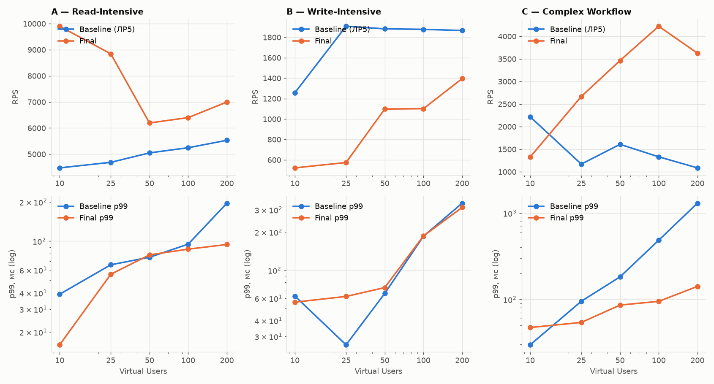
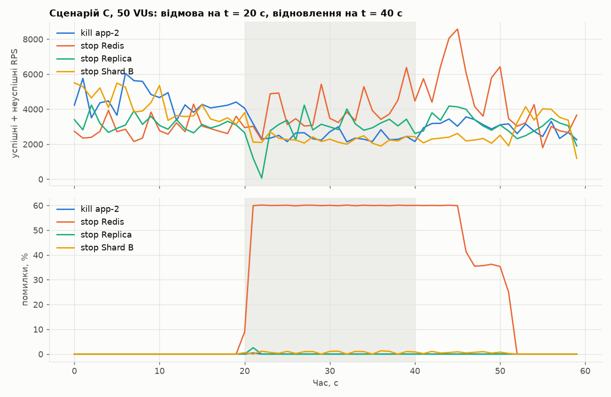

# ЛР № 10 — Final Optimization та Architecture Review

## 1. Фінальна архітектура (C4 — Container level)

Відображено лише фактично реалізовані й запущені компоненти (`compose.yaml`).

```mermaid
flowchart TB
    client(["Клієнт<br/>браузер / мобільний застосунок / k6"])

    subgraph edge [Edge]
        lb["<b>Load Balancer</b><br/>nginx 1.27, 1 CPU<br/>Least Connections, keepalive, passive health check<br/>:8080 — єдина публічна точка входу"]
    end

    subgraph appTier [Application tier — stateless, 3 × (1 CPU / 768 MB)]
        app["<b>Shop API</b> app-1..3<br/>Spring Boot 3.5 / Java 21<br/>REST/JSON · Cache-Aside + StampedeGuard · Bloom<br/>RoutingDataSource (R/W split) · ShardRouter (virtual buckets) · Saga"]
    end

    subgraph data [Data tier]
        redis[("<b>Redis 7.4</b> (AOF)<br/>сесії, кошики · кеш shop:* ·<br/>locks, fences, Bloom, feature flags")]
        subgraph catalog [Catalog DB]
            cp[("<b>PostgreSQL Primary</b><br/>users, products, stock,<br/>shard_buckets · 2 CPU")]
            cr[("<b>PostgreSQL Replica</b><br/>hot standby · 2 CPU")]
        end
        subgraph shards [Order shards — key: user_id, 1024 buckets]
            sa[("<b>Shard A</b><br/>orders, order_items<br/>buckets 0–511 · 2 CPU")]
            sb[("<b>Shard B</b><br/>orders, order_items<br/>buckets 512–1023 · 2 CPU")]
        end
    end

    client -- "HTTP/1.1" --> lb
    lb -- "HTTP keepalive" --> app
    app -- "RESP (Lettuce)" --> redis
    app -- "JDBC: writes, strict reads,<br/>Saga T1 (stock)" --> cp
    app -- "JDBC: eventual reads" --> cr
    cp == "WAL streaming (async)" ==> cr
    app -- "JDBC: shard-local (user_id)<br/>scatter-gather (analytics)" --> sa & sb
```

| Компонент | Роль | Звідки (ЛР) |
|---|---|---|
| nginx | Single Entry Point, балансування, пасивні health checks, retry на інший вузол | 3 |
| app-1..3 | stateless обробка; будь-який інстанс обробляє будь-який запит | 1, 2, 3 |
| Redis | спільний стан (сесії, кошики) + розподілений кеш + координація (lock, fence, Bloom, flags) | 2, 4, 6, 8 |
| Catalog Primary / Replica | каталог, користувачі, склад; R/W split, RYW-fence, primary fallback | 6 |
| Shard A / B | замовлення, ключ `user_id`, virtual buckets, Saga для checkout | 7 |

## 2. Request Flow: «покупка» (сценарій C) — затримки, відмови, захист

Латентності — медіанні спани з distributed tracing (ЛР9, OpenTelemetry → Jaeger, 10 VUs) та `pg_stat_statements`.

| Крок | Запит | Компонент → залежність | Типова затримка | Failure Mode | Захисний механізм (Fallback) |
|---|---|---|---|---|---|
| 0 | будь-який | клієнт → **nginx** → app | ~0.3–0.6 мс накладних витрат LB | інстанс упав / завис | passive health check + `proxy_next_upstream` на інший вузол; POST не повторюється після відправки (немає дублів) |
| 1 | `GET /api/products?categoryId` | app → **Redis** (`GET` версії категорії + `GET` сторінки) | HIT: 1–2 мс; MISS → **Replica** `Index Scan` ~0.2 мс | Redis недоступний | circuit breaker 5 с → `X-Cache: BYPASS`, читання з БД |
| 2 | `GET /api/products/{id}` | app → **Redis** `EVALSHA` (Bloom) + `GET` | 0.4 + 0.8 мс (трейс) | неіснуючий id (penetration) / одночасний MISS (stampede) / Replica відстає | Bloom → 404 без кешу й БД; single-flight + Redis lock (1 перерахунок); fence → читання з Primary 5 с після зміни |
| 3 | `POST /api/cart/items` | app → **Redis** `GETEX` сесії, `HINCRBY` кошика | ~0.3 + 0.3 мс | Redis недоступний | контрольований **503** «Session store unavailable» (каталог при цьому працює) |
| 4 | `POST /api/orders` | **Saga**: T1 **Catalog Primary** (`FOR UPDATE`, `UPDATE stock`, COMMIT) → T2 **Shard(user)** (`INSERT orders/items`) | T1 ≈ 1.1 мс SQL + COMMIT, T2 ≈ 0.9 мс; разом 14 мс у трейсі (з 7 командами Redis) | недостатньо товару; Primary недоступний; шард недоступний; пул вичерпано | 409 без змін; **503 read-only mode**; компенсація C1 (повернення залишку); **503 overloaded + Retry-After** (не виводить вузол з LB) |
| 5 | `GET /api/orders/my` | app → **Shard(user)**: `Index Scan` + 1 batch `order_items` | 0.48 + 0.29 мс (трейс), разом 2.2 мс | шард недоступний | 503 (історія лише для власного шарду; інші шарди не зачіпаються) |
| — | `GET /api/stats/top-products` | app → Redis; MISS → scatter-gather на **всі шарди** + Replica | HIT ~2 мс; live ~300 мс при 20 VUs | stampede на холодному ключі | lock + single-flight: 500 одночасних MISS → **1** перерахунок (ЛР8) |

## 3. Фінальна оптимізація

ЛР9 показала, що після прибирання вузького місця в БД система переходить у **ретроградну ділянку** кривої масштабованості: 200 потоків Tomcat на інстанс з **1 CPU** конкурують за процесор (перемикання контексту, CFS throttling), а Round Robin рівняє весь пул по найповільнішому (найгірше прогрітому JIT) інстансу. Фінальна оптимізація прибирає саме це.

### 3.1 Обмеження конкурентності та алгоритм балансування

`TOMCAT_MAX_THREADS` (пул потоків на інстанс) × алгоритм nginx, 100 VUs, після повного прогріву ([`scripts/lab10-tuning2.sh`](../scripts/lab10-tuning2.sh); алгоритм перемикається наживо на тих самих JVM):

| Сценарій | Tomcat threads | LB | RPS (2 прогони) | p95, мс | p99, мс |
|---|---|---|---|---|---|
| A | 200 | Round Robin | 4013, 4524 | 88.1 | 127.4 |
| A | 200 | Least Connections | 4574, 4818 | 61.6 | 84.8 |
| A | 16 | Round Robin | 4829, 5497 | 75.9 | 104.7 |
| A | 16 | Least Connections | 6601, 6348 | 55.9 | 64.8 |
| C | 200 | Round Robin | 2231, 2363 | 162.8 | 261.3 |
| C | 200 | Least Connections | 2797, 2937 | 100.8 | 148.0 |
| C | 16 | Round Robin | 3118, 3497 | 101.9 | 164.9 |
| C | 16 | Least Connections | 4072, 4424 | 69.8 | 95.4 |

* **200 → 16 потоків** (Round Robin): C +44 %, A +21 %, p99 C 261 → 165 мс. Запити, що не вміщуються в пул, чекають у черзі прийому Tomcat, а не конкурують за CPU, тож кожен виконується швидше (класичний **bulkhead / admission control**).
* **Round Robin → Least Connections** (16 потоків): ще C +28 %, A +25 %, p99 A 105 → 65 мс. LC не відправляє запити на вузол, який зараз повільніший (ЛР3, асиметричне навантаження).
* **Разом:** C **2 300 → 4 250 RPS (+85 %)**, p99 **261 → 95 мс**; A **4 270 → 6 470 RPS (+52 %)**, p99 **127 → 65 мс**.

Свіп розміру пулу на всіх трьох профілях (Least Connections, 100 VUs, [`scripts/lab10-tuning3.sh`](../scripts/lab10-tuning3.sh); формат RPS / p99):

| Tomcat threads | A | B | C |
|---|---|---|---|
| 16 | 5525 / 87 мс | 1841 / 115 мс | 3925 / 114 мс |
| 32 | 6525 / 92 мс | 1525 / 151 мс | 3542 / 173 мс |
| 64 | 5353 / 90 мс | 1565 / 118 мс | 2954 / 159 мс |
| 200 | 5306 / 92 мс | 1686 / 147 мс | 2924 / 155 мс |

Обрано **16 потоків на 1-CPU інстанс + Least Connections** (тепер це значення за замовчуванням у `compose.yaml` та `application.yml`). Правило: для CPU-bound сервісу пул потоків має бути порядку кількості ядер × (1 + час_очікування / час_CPU), а не «200 за замовчуванням». Для fsync-bound запису (B) більший пул дає більше транзакцій в одному груповому коміті, але різниця в межах розкиду прогонів (див. 4.2).

### 3.2 Виправлення, знайдене при ревізії відмов

Сценарій «Redis недоступний 20 с» (розділ 7) показав, що після повернення Redis застосунок **ще ≥ 17 с** віддавав 503: Lettuce перепідключається з експоненційним backoff до 30 с, і за час відмови інтервал між спробами встиг вирости. У [`RedisConfig`](../src/main/java/ua/highload/shop/config/RedisConfig.java) backoff обмежено **1 с**, і повне відновлення тепер займає ~10 с від старту контейнера Redis, з них ~3 с — завантаження AOF.

## 4. Baseline vs Final

**Методика тотожного середовища.** Baseline виміряно **повторно**, а не взято з ЛР5. Причина: у ЛР5 таблиця `orders` росла від прогону до прогону (103k → 443k рядків), і сценарій C виконувався на значно більших даних, ніж решта. Тепер:

* **Baseline** — код з тегу `lab5` (git worktree), окремий compose-проєкт `shopbase` зі свіжими томами: 1 PostgreSQL, Redis-кеш, nginx Round Robin, 3 × app, 200 потоків Tomcat;
* **Final** — поточний стек;
* однакові ліміти ресурсів (`cpus`/`mem_limit`), той самий хост, той самий профіль ЛР5 (сценарії A/B/C × 10/25/50/100/200 VUs по 30 с), повний прогрів усіх кодових шляхів, **скидання даних до seed-стану (50k замовлень) перед кожним виміром**;
* скрипт: [`scripts/lab10-compare.sh`](../scripts/lab10-compare.sh) (`CONFIG=baseline|final`), таблиці й графік: [`scripts/plot_lab10.py`](../scripts/plot_lab10.py).

Stable Throughput — максимальний RPS серед ступенів, де p95 ≤ 250 мс і помилок < 1 %. Saturation Threshold — найменша кількість VUs, при якій досягнуто ≥ 90 % максимального RPS.

### 4.1 Підсумкова таблиця

##### A — Read-Intensive

| Метрика продуктивності | Початковий стан (Lab 5 Baseline) | Фінальний стан (Final Architecture) | Приріст / Оптимізація |
|---|---|---|---|
| Stable Throughput (RPS; p95 ≤ 250 мс; помилки < 1 %) | 5 530 | 9 901 | +79 % |
| p50 Latency @ 100 VUs, мс | 5.6 | 3.9 | -31 % |
| p95 Latency @ 100 VUs, мс | 83.2 | 73.3 | -12 % |
| p99 Tail Latency @ 100 VUs, мс | 94.8 | 86.8 | -8 % |
| Error Rate at Saturation (200 VUs) | 0.00 % | 0.00 % | — |
| Saturation Threshold (VUs, ≥ 90 % від max RPS) | 50 | 10 | — |

<details><summary>Повна таблиця по ступенях навантаження</summary>

| VUs | Baseline RPS | Final RPS | Baseline p95 / p99, мс | Final p95 / p99, мс | Errors B / F |
|---|---|---|---|---|---|
| 10 | 4474 | 9901 | 3.2 / 39.1 | 1.3 / 16.0 | 0.00 / 0.00 % |
| 25 | 4686 | 8843 | 36.9 / 65.8 | 5.3 / 55.7 | 0.00 / 0.00 % |
| 50 | 5048 | 6195 | 63.2 / 75.2 | 55.1 / 78.4 | 0.00 / 0.00 % |
| 100 | 5246 | 6400 | 83.2 / 94.8 | 73.3 / 86.8 | 0.00 / 0.00 % |
| 200 | 5530 | 6997 | 164.7 / 195.6 | 87.9 / 94.2 | 0.00 / 0.00 % |

</details>

##### B — Write-Intensive

| Метрика продуктивності | Початковий стан (Lab 5 Baseline) | Фінальний стан (Final Architecture) | Приріст / Оптимізація |
|---|---|---|---|
| Stable Throughput (RPS; p95 ≤ 250 мс; помилки < 1 %) | 1 908 | 1 396 | -27 % |
| p50 Latency @ 100 VUs, мс | 39.4 | 90.5 | +130 % |
| p95 Latency @ 100 VUs, мс | 126.8 | 110.2 | -13 % |
| p99 Tail Latency @ 100 VUs, мс | 185.3 | 186.3 | +1 % |
| Error Rate at Saturation (200 VUs) | 0.00 % | 0.00 % | — |
| Saturation Threshold (VUs, ≥ 90 % від max RPS) | 25 | 200 | — |

<details><summary>Повна таблиця по ступенях навантаження</summary>

| VUs | Baseline RPS | Final RPS | Baseline p95 / p99, мс | Final p95 / p99, мс | Errors B / F |
|---|---|---|---|---|---|
| 10 | 1258 | 522 | 42.6 / 62.4 | 50.5 / 55.9 | 0.00 / 0.00 % |
| 25 | 1908 | 574 | 17.7 / 25.7 | 54.0 / 62.0 | 0.00 / 0.00 % |
| 50 | 1883 | 1098 | 50.9 / 65.5 | 58.7 / 72.8 | 0.00 / 0.00 % |
| 100 | 1878 | 1101 | 126.8 / 185.3 | 110.2 / 186.3 | 0.00 / 0.00 % |
| 200 | 1867 | 1396 | 259.6 / 337.9 | 203.5 / 313.1 | 0.00 / 0.00 % |

</details>

##### C — Complex Workflow

| Метрика продуктивності | Початковий стан (Lab 5 Baseline) | Фінальний стан (Final Architecture) | Приріст / Оптимізація |
|---|---|---|---|
| Stable Throughput (RPS; p95 ≤ 250 мс; помилки < 1 %) | 2 218 | 4 223 | +90 % |
| p50 Latency @ 100 VUs, мс | 13.7 | 12.2 | -11 % |
| p95 Latency @ 100 VUs, мс | 286.2 | 74.0 | -74 % |
| p99 Tail Latency @ 100 VUs, мс | 484.5 | 94.8 | -80 % |
| Error Rate at Saturation (200 VUs) | 0.00 % | 0.00 % | — |
| Saturation Threshold (VUs, ≥ 90 % від max RPS) | 10 | 100 | — |

<details><summary>Повна таблиця по ступенях навантаження</summary>

| VUs | Baseline RPS | Final RPS | Baseline p95 / p99, мс | Final p95 / p99, мс | Errors B / F |
|---|---|---|---|---|---|
| 10 | 2218 | 1328 | 13.3 / 29.7 | 41.7 / 47.1 | 0.00 / 0.00 % |
| 25 | 1171 | 2669 | 86.8 / 95.0 | 44.9 / 54.0 | 0.00 / 0.00 % |
| 50 | 1609 | 3463 | 108.6 / 182.1 | 55.6 / 85.7 | 0.00 / 0.00 % |
| 100 | 1332 | 4223 | 286.2 / 484.5 | 74.0 / 94.8 | 0.00 / 0.00 % |
| 200 | 1087 | 3627 | 725.5 / 1301.9 | 98.7 / 141.2 | 0.00 / 0.00 % |

</details>

saved docs/img/lab10-baseline-vs-final.png



##### Утилізація CPU при 100 VUs (ядер)

| Сценарій | Конфігурація | app Σ (3 × 1 CPU) | nginx | Redis | Catalog Primary | Replica | Shard A | Shard B |
|---|---|---|---|---|---|---|---|---|
| A | baseline | 2.70 | 0.49 | 0.13 | 0.07 | — | — | — |
| A | final | 3.00 | 0.62 | 0.28 | 0.02 | 0.06 | 0.02 | 0.01 |
| B | baseline | 2.59 | 0.27 | 0.16 | 1.95 | — | — | — |
| B | final | 1.89 | 0.18 | 0.15 | 0.73 | 0.07 | 0.40 | 0.45 |
| C | baseline | 1.39 | 0.15 | 0.10 | 1.89 | — | — | — |
| C | final | 2.80 | 0.42 | 0.37 | 0.44 | 0.15 | 0.32 | 0.35 |

### 4.2 Чесно про запис (сценарій B): регресія −27…−45 %

Фінальна архітектура пише **повільніше** за baseline (1 100–1 400 проти ~1 900 замовлень/с). Повторний прогін B дав 478 / 847 / 1 329 / 1 071 / 1 118 RPS для 10…200 VUs, тож результат відтворюється.

**Доказ причини.** Distributed trace повільного `POST /api/orders` показує два розриви по 17–23 мс: одразу після `UPDATE products` (COMMIT T1 у каталозі) і після `INSERT order_items` (COMMIT T2 на шарді). CPU при цьому ніде не насичений: застосунок 0.2–0.65, каталог 0.3–0.8, шарди ~0.4. Контрольний експеримент (2 повтори, B · 25 VUs) — `synchronous_commit` на каталозі й шардах тимчасово вимкнено:

| `synchronous_commit` | RPS | p50, мс | p99, мс |
|---|---|---|---|
| on (штатно) | 695 / 728 | 37.4 / 38.2 | 64.1 / 82.9 |
| off (лише діагностика) | 3 758 / 4 464 | 2.0 / 1.8 | 65.5 / 62.1 |

Запис **у 5.4–6.1 раза** швидший без очікування fsync, тобто шлях запису обмежений **латентністю fsync WAL**. На цьому стенді всі 5 вузлів PostgreSQL ділять один NVMe під **btrfs (CoW, zstd)**: ізольований `fdatasync` займає 1.4–6.2 мс (`pg_test_fsync`), а під конкурентними fsync від кількох БД COMMIT доходить до ~20 мс. **Saga робить два синхронні коміти в різних БД** на кожне замовлення, а baseline — один. Обмеження пулу потоків (16) додатково зменшує кількість транзакцій в одному груповому коміті.

Це артефакт стенду (в продакшні кожен вузол БД має власне сховище, і fsync двох вузлів не конкурує), але він виявив реальну ціну Saga: **два синхронні коміти на критичному шляху замість одного**. `synchronous_commit=off` не застосовано, бо це означає втрату підтверджених замовлень при збої. Шляхи виправлення:

1. Окреме сховище для кожного вузла БД (у продакшні так і є).
2. **Один синхронний коміт на критичному шляху:** записати замовлення разом із резервом складу в одній транзакції каталогу у вигляді outbox-запису (transactional outbox), а на шард переносити асинхронно (CDC/воркер). Клієнт отримує 201 після одного COMMIT.
3. Групові коміти: `commit_delay`/`commit_siblings` дають ефект при високій конкурентності запису.

## 5. Attribution of Improvements

Кожне покращення зв'язано з конкретною зміною і **кількісним доказом з контрольованого експерименту** відповідної ЛР:

| Покращення (Final vs Baseline) | Компонент / оптимізація | Доказ |
|---|---|---|
| **Навантаження на СУБД при читанні −99.8 %** (A: ~6 000 → ~10 SQL/с) | Redis Cache-Aside (ЛР4) | ЛР5, Cache Disabled vs Enabled |
| **Throughput читання A +79 % (stable), p99 −8…−52 %** | обмеження потоків Tomcat + Least Connections (ЛР10) | розділ 3.1: +52 % RPS, p99 127 → 65 мс на тих самих JVM |
| Read-трафік БД знято з Primary (0 SQL/с) | Read Replica + R/W routing (ЛР6) | ЛР6: Primary 0.01 ядра, Replica 0.8 |
| **Запит історії: 2.78 → 0.053 мс (×52), ендпоінт ×3.3 RPS, p99 −56 %** | складений індекс на шардах + усунення N+1 (ЛР9) | ЛР9, ABAB: індекс +99 %, batch +81 % |
| **C ×2 на тих самих даних** (до індексу) | шардинг замовлень за `user_id`, 2 вузли (ЛР7) | ЛР7, Single vs Sharded: C 1 500 → 2 830–3 250 RPS |
| **C: throughput +90 %, p99 @100 VUs 485 → 95 мс (−80 %)** | сукупно: індекс + batch (ЛР9) зняли насичення БД (CPU шардів 2.0 → 0.5), а обмеження потоків + LC (ЛР10) — ретроградну конкурентність застосунку | ЛР9 + розділ 3.1 (C +85 % на тих самих JVM) |
| **Ліквідація сплесків p99 на холодному гарячому ключі:** 2.1–5.5 с → 93 мс, помилки 14 % → 0 | Stampede protection: single-flight + Redis lock (ЛР8) | ЛР8, 500 одночасних MISS: 126–164 перерахунки → 1 |
| Пік навантаження при масовому вигасанні −54 % | TTL jitter (ЛР8) | ЛР8, Avalanche: 915 → 417 SQL/с |
| Запити до БД від неіснуючих id −100 % | Bloom filter + negative cache (ЛР8) | ЛР8, Penetration |
| Відсутність каскадних відмов під перевантаженням (37 % → 0.17 % помилок) | 503 load shedding не виводить вузол з LB (ЛР6) | ЛР6, replica-C-200 |
| **Запис B −27 %** (регресія) | Saga = два синхронні коміти + fsync на спільному btrfs | розділ 4.2, `synchronous_commit` off → ×5.4–6.1 |

## 6. Scaling Limits

Утилізація при 100 VUs (розділ 4.1) і запас кожного компонента при збільшенні навантаження у 2–5 разів від поточного максимуму:

| Компонент | Зараз (найгірший сценарій) | Ліміт | Насичується при | Як масштабувати |
|---|---|---|---|---|
| **App tier (3 × 1 CPU)** | **3.00 з 3** (A), 2.80 (C) | 3 CPU | **уже насичений** для читання | горизонтально (stateless): +N інстансів лінійно (ЛР3), до межі nginx |
| **nginx (1 CPU)** | 0.62 при ~6.4k RPS (A) | ~10k RPS | **~1.6×** read-навантаження | 2+ LB (VRRP), більше CPU, L4-балансування |
| **Catalog Primary (запис складу)** | 0.73 ядра, але COMMIT ~20 мс (B) | fsync WAL | **уже межа запису** (~1.1–1.9k замовлень/с) | окреме сховище; один коміт на критичному шляху (outbox); шардинг складу за `product_id` |
| Redis (1 потік) | 0.37 (C), 0.28 при 6.4k RPS (A) | ~1 ядро | ~3× | менше round-trip'ів (pipelining, Lua), Redis Cluster |
| Shards A/B | 0.32–0.45 з 2 | 2 CPU кожен | ~4–5× | додати шард (virtual buckets: −1/N даних, ЛР7) |
| Replica | 0.06–0.15 з 2 | 2 CPU | ≫ 5× (кеш віддає 99 % читань) | — |

**Висновок:** при зростанні навантаження у 2–5 разів **першими насичуються CPU застосунку для читання** (знімається додаванням інстансів) і **nginx (~1.6×)**. Структурне обмеження, яке не знімається горизонтальним масштабуванням застосунку, — **шлях запису через Catalog Primary** (кожне замовлення синхронно комітить резерв складу в одній БД). Це наступний крок масштабування.

## 7. Failure Scenarios Review (під навантаженням)

Сценарій C, 50 VUs, 60 с: відмова на t = 20 с, відновлення (start) на t = 40 с ([`scripts/lab10-failures.sh`](../scripts/lab10-failures.sh), посекундні ряди: `results/lab10/failures/*-timeseries.csv`).

| Відмова (t = 20…40 с) | До: RPS / err / max p99 | Під час: RPS / err / max p99 | Після (t = 45…58 с): RPS / err / max p99 |
|---|---|---|---|
| kill app-2 | 4542 / 0.0 % / 149 мс | 2472 / 0.0 % / 174 мс | 2987 / 0.0 % / 135 мс |
| stop Redis | 2988 / 0.0 % / 178 мс | 3733 / 60.0 % / 148 мс | 4324 / 27.9 % / 200 мс |
| stop Replica | 3099 / 0.0 % / 141 мс | 2843 / 0.1 % / 1587 мс | 3116 / 0.0 % / 209 мс |
| stop Shard B | 4181 / 0.0 % / 98 мс | 2224 / 0.7 % / 1506 мс | 2934 / 0.3 % / 1280 мс |
saved docs/img/lab10-failures.png



| Відмова | Рівень деградації (Graceful Degradation) | Механізм |
|---|---|---|
| **kill app-2** | **0 % помилок**; throughput −45 % (лишилось 2 з 3 вузлів), після рестарту інстанс повертається в пул (холодний JIT, тому відновлення поступове) | passive health check nginx + `proxy_next_upstream` (ЛР3), stateless (ЛР2) |
| **stop Redis** | ~60 % запитів отримують **контрольований 503** (логін/кошик/checkout/історія потребують сесії); **каталог і картки працюють** (BYPASS); `/health` = DEGRADED, тож вузли не виводяться з пулу. Повне відновлення ~10 с після старту Redis | circuit breaker кешу, fail-open Bloom/lock, 503 для сесій (ЛР4), capped reconnect backoff (ЛР10) |
| **stop Replica** | 0.1 % помилок, разовий сплеск p99 до 1.6 с: перші запити чекають `connectionTimeout` 1.5 с, після чого Replica позначається DOWN і читання йдуть на Primary | Primary Fallback, ReplicaHealth (ЛР6) |
| **stop Shard B** | **0.3–0.7 % помилок**: зачеплено лише користувачів шарду B (≈50 %), чиї запити історії/checkout отримують 503 після 1.5 с; користувачі шарду A не помічають відмови. Шард повертається ~10 с після старту | ізоляція шардів (blast radius = 1/N), таймаут пулу 1.5 с (ЛР7) |

Низький відсоток помилок для шарду в closed-моделі навантаження оманливий: VU, чий запит висить 1.5 с до 503, відправляє в десятки разів менше запитів. Насправді недоступна приблизно половина checkout'ів.

## 8. SPOF Analysis

| SPOF | Наслідок відмови | Чому не усунено (trade-off) | Як усунути |
|---|---|---|---|
| **nginx (єдиний LB)** | 100 % недоступність | один хост розробки; другий LB без VIP нічого не дає | 2 × LB + keepalived/VRRP (плаваюча IP), або хмарний L4 LB |
| **Catalog Primary** | запис (checkout, реєстрація, логін за паролем) → `503 read-only`; каталог, історія і кеш працюють | автоматичний failover без кворуму ризикує split-brain; Patroni + etcd (3 вузли) — ще 3–4 контейнери | Patroni / pg_auto_failover + Replica як кандидат у Primary |
| **Shard A / Shard B (без реплік)** | користувачі «свого» шарду (≈50 %) не можуть оформити замовлення і бачити історію; інші шарди працюють (blast radius = 1/N) | кожна репліка шарду — ще 2 CPU / 1 GB; на 16-потоковому хості це вже більше, ніж весь застосунок | Primary + Replica на кожен шард (як у каталозі) + failover |
| **Redis (один вузол)** | сесії і кошики недоступні → логін/кошик/checkout `503`; каталог працює через BYPASS | Sentinel або Cluster — 3+ вузли; AOF вже зберігає дані при рестарті | Redis Sentinel (3 вузли) або Redis Cluster; сесії — JWT замість серверного стану |
| `shard_buckets` (таблиця в каталозі) | маршрутизація продовжує працювати з кешованої копії (оновлюється раз на 5 с) | — | (не SPOF на коротких інтервалах) |

## 9. Consistency Trade-offs

| Дані / операція | Модель | Механізм | Можливе застарівання |
|---|---|---|---|
| Залишок на складі при checkout | **Strong** (ACID в одній БД) | `SELECT … FOR UPDATE` на Catalog Primary | немає |
| Замовлення ↔ склад | **Eventual** (Saga) | T1 (каталог) → T2 (шард) → C1 компенсація | між T1 і T2 (мілісекунди) резерв є, замовлення ще немає; при падінні процесу посередині — «завислий» резерв (потрібен reconciler) |
| Історія та деталі власних замовлень | **Strong** | шард без реплік: читання з Primary шарду | немає |
| Автентифікація, власний профіль, підтвердження замовлення | **Strong** | Explicit Primary Routing | немає |
| Каталог, картка товару, категорії | **Eventual** | Replica + кеш (TTL 60 с / 5 хв) + інвалідація | ціна/назва: одразу (write-through / версія категорії); `stock` у картці — до 5 с (fence) |
| Read-Your-Own-Writes після запису | **RYW** | write fence у Redis (5 с → Primary) | немає для автора; інші бачать через ≤ лаг |
| Аналітика (top-products, sales) | **Eventual** | кеш 30 с; fan-out по шардах | до 30 с |
| Лічильник `stats:orders-created` | **Best effort** | Redis `INCR` після COMMIT | інкремент губиться, якщо Redis недоступний |

Підсумок за PACELC: система **PA/EL** для читань каталогу (доступність і латентність важливіші) і **PC/EC** для грошей і складу (503 замість ризику неконсистентності).

## 10. Cost of Complexity

**Ціна поточної архітектури:** 8 довгоживучих контейнерів замість 2 у ЛР1 (5 вузлів PostgreSQL, Redis, nginx, 3 інстанси застосунку). Міграції на кожному шарді, Saga замість транзакції, відсутність FK, fan-out аналітики, write fence, feature flags, Bloom. Кожен механізм має власні Failure Modes (ЛР8). Майже кожен експеримент виявив нетривіальну взаємодію шарів: каскадну відмову через 503 → health check (ЛР6), RYW-гарантію, що тихо залежала від прапорця кешу (ЛР6), ретроградну конкурентність після оптимізації БД (ЛР9).

**Що вилучити, якби навантаження зменшилось у 10 разів** (~300 RPS читання, ~150–200 замовлень/с):

| Компонент | Рішення | Обґрунтування |
|---|---|---|
| **Шардинг** | **прибрати**: усі бакети → один вузол, потім повернути замовлення в БД каталогу | у ЛР7 один вузол витримав ~1.5k RPS сценарію C, а після індексу (ЛР9) запит історії коштує 0.05 мс. Шардинг потрібен для обсягу даних і запису, а не для 200 замовлень/с. Повертається ACID-checkout без Saga і FK |
| **Read Replica** | лишити **як standby для відмовостійкості**, але читання вести з Primary | при 10× меншому навантаженні Primary використовує < 0.3 CPU; репліка корисна для failover і бекапів, а не для масштабування |
| **Stampede lock, Bloom, TTL jitter, negative cache** | лишити single-flight і jitter (дешеві, локальні); Bloom і distributed lock — прибрати | при 10× меншому трафіку одночасних MISS на ключ одиниці; Bloom — захист від атак, його функцію може взяти rate limiting на LB |
| **3 інстанси застосунку** | **2** (не 1) | один інстанс зі 1 CPU витримує ~3k RPS читання (ЛР3/ЛР5); другий — для відмовостійкості й rolling deploy |
| **Redis** | лишити | сесії, кошики і кеш — найдешевший спосіб лишатися stateless |
| **nginx** | лишити | потрібен навіть для 2 інстансів |

Тобто «мінімальна достатня» архітектура при 10× меншому навантаженні — це ЛР4 + індекс із ЛР9 + standby-репліка: 2 × app, nginx, Redis, PostgreSQL Primary + Standby.

## 11. Final System Engineering Summary

```
=== FINAL SYSTEM ENGINEERING SUMMARY ===
Architecture Style:    Stateless modular monolith (3 replicas behind nginx, Least Connections)
                       + Redis distributed cache/state + PostgreSQL Primary/Replica (catalog)
                       + application-level sharding of orders by user_id (1024 virtual buckets, 2 shards)
Primary Workload Type: Mixed — read-heavy catalog (cache-served) with write-heavy checkout bursts
Stable Throughput:     A (read)  ≈ 9 900 RPS @10 VUs, 6 400–7 000 RPS @100–200 VUs   (baseline 5 530)
                       C (mixed) ≈ 4 220 RPS ≈ 840 workflows/s @100 VUs              (baseline 2 220)
                       B (write) ≈ 1 100–1 400 orders/s                              (baseline 1 910)
p95 / p99 Latencies:   A @100 VUs: 73 / 87 ms;  C @100 VUs: 74 / 95 ms (baseline 286 / 485 ms);
                       B @100 VUs: 110 / 186 ms
Saturation Point:      A ≤ 10 VUs (app CPU), C ≈ 100 VUs, B ≈ 50 VUs (WAL fsync)
Main Bottleneck:       reads — app tier CPU (3 × 1 CPU), next nginx at ~1.6×;
                       writes — synchronous commits on Catalog Primary + shard (Saga, 2 × fsync)
Resilience Strategy:   passive health checks + retry (LB), Least Connections, Tomcat bulkhead (16 thr),
                       cache circuit breaker + BYPASS, single-flight + Redis lock, TTL jitter,
                       negative cache + Bloom filter, replica Primary Fallback, read-only mode,
                       503 load shedding with Retry-After, Saga compensation, capped reconnect backoff
Consistency Model:     Strong — stock/checkout, own orders, auth; Read-Your-Own-Writes (write fence);
                       Eventual — catalog, product cards, analytics (replica + cache, ≤ TTL);
                       Eventual between stock and order (Saga)
Identified SPOFs:      nginx LB; Catalog Primary (writes); each order shard (no replicas); Redis (sessions)
Next Scaling Step:     write path — transactional outbox (1 sync commit per checkout) + dedicated storage
                       per DB node; Redis Sentinel; shard replicas; fewer Redis round-trips (pipelining)
```

## 12. Порядок фінального захисту (шпаргалка)

1. **System Design:** розділи 1–2 (діаграма + Request Flow для покупки).
2. **Live Load Testing:** `CONFIG=final scripts/lab10-compare.sh` (або окремий прогін `k6 run -e SCENARIO=C -e VUS=100 load-tests/scenarios.js`); пояснити Stable RPS, p95/p99 і насичення з таблиць розділу 4.
3. **Live Failure Scenario:** `scripts/lab10-failures.sh` — `kill` інстансу, `stop` Redis, `stop` Replica під навантаженням (розділ 7).
4. **Інженерний захист:** SPOF (розділ 8), консистентність (9), вартість складності (10), Attribution (5).
